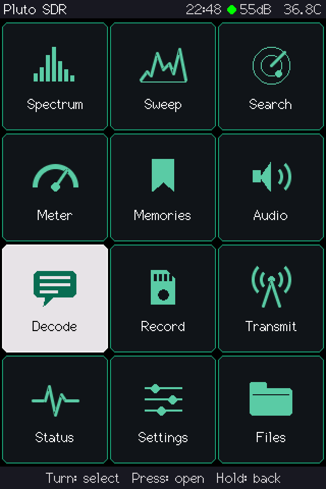
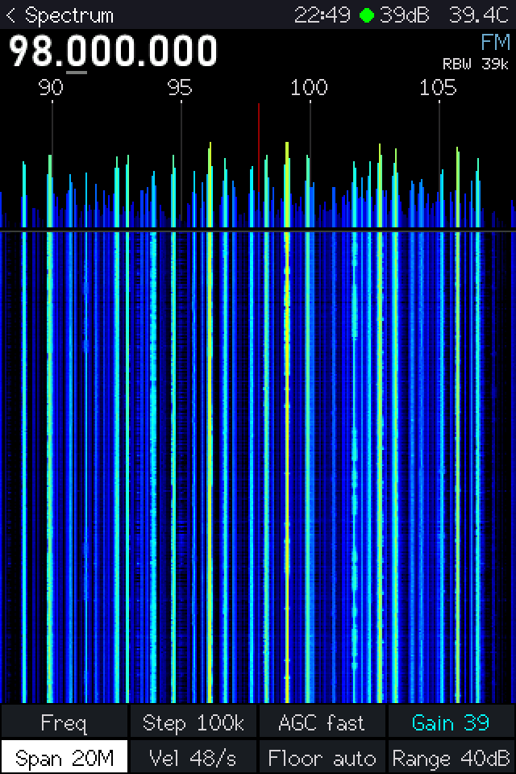
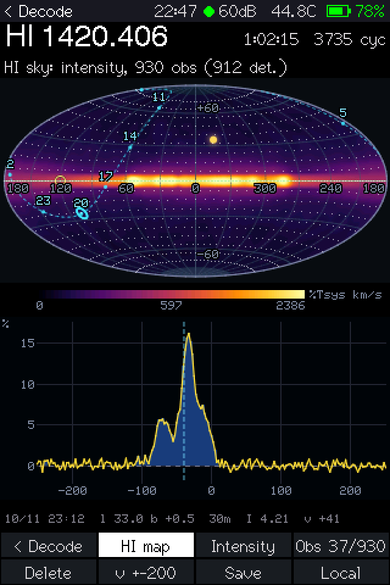
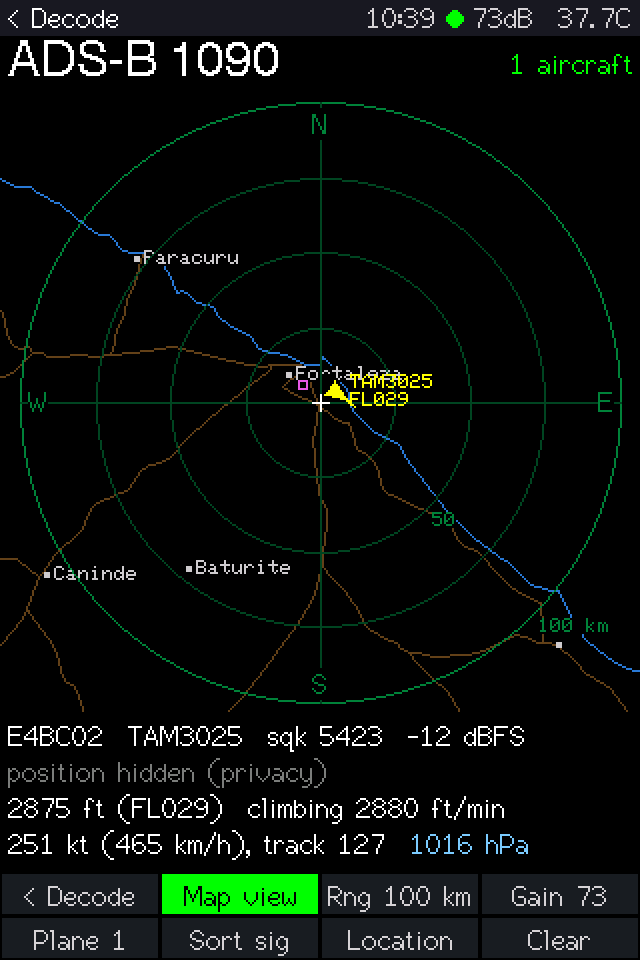

# Portable SDR — ESP32-S3 + Pluto SDR

A handheld radio from 70 MHz to 6 GHz: spectrum and waterfall (with integrated spectrum, traces and
fine RBW), audio (AM, FM, SSB and CW) with automatic noise reduction, recording, decoders (RDS, ADS-B,
AIS, APRS, radiosondes, VOR, FPV drones), hydrogen-line radio astronomy, satellite pass prediction with Doppler correction, an RF
oscilloscope and **amateur radio transmit** on 2 m and 70 cm (test tone, WAV file in NFM, USB or
LSB, CW identification and CW messages, tracking generator).
All of it on a 3.5" touch screen with a rotary encoder, running on a battery.

<p>




</p>

- The **Pluto SDR** is the radio: it captures the signal, computes the spectrum, demodulates the
  audio and decodes ADS-B, AIS and RDS.
- The **ESP32-S3** is the Pluto's USB host and owns the user interface: screen, touch, encoder,
  speaker and SD card. It also decodes APRS, radiosondes and VOR, and predicts satellite passes.

The device is mainly a receiver. The **Transmit** app is for **licensed radio amateurs** and only
transmits on the 2 m (144–148 MHz) and 70 cm (430–440 MHz) bands, with an on-screen confirmation and
an automatic cut-off if the ESP32 stops responding. See [Transmit](docs/apps/transmit.md).

> **Closed source.** This repository holds the ready-made binaries (ESP32 and Pluto), the SD card
> files and the documentation. The source code is not distributed.

---

## Apps

Every app has its own page with screenshots.

| App | What it does |
|---|---|
| [Everywhere](docs/apps/general.md) | Status bar, gestures, keypads, screenshots, touch lock |
| [Spectrum](docs/apps/spectrum.md) | Live spectrum and waterfall, 10 kHz to 56 MHz wide, traces, fine RBW |
| [Sweep](docs/apps/sweep.md) | Wide bands (up to 70 MHz–6 GHz) built from radio hops |
| [Search](docs/apps/search.md) | List of signals above a threshold |
| [Meter](docs/apps/meter.md) | Signal level, fox-hunt beep, RF oscilloscope |
| [Memories](docs/apps/memories.md) | Named frequencies, memory scanner, ignore list |
| [Audio](docs/apps/audio.md) | AM, NFM, WFM, USB, LSB, CW with squelch, noise reduction, EQ, zoom, Doppler |
| [Record](docs/apps/record.md) | Records the audio to WAV on the SD card |
| [Decode](docs/apps/decode.md) | RDS, ADS-B, AIS, radiosondes, APRS, VOR, satellites, FPV drones, radio astronomy |
| [Files](docs/apps/files.md) | SD card browser, WAV player and waveform viewer |
| [Status](docs/apps/status.md) | Link, radio and device state |
| [Settings](docs/apps/settings.md) | Display, clock, calibrations, backups, firmware updates |
| [Transmit](docs/apps/transmit.md) | Amateur radio TX: tone, WAV, CW, tracking generator |

## Documentation

| Document | Contents |
|---|---|
| [Components](docs/COMPONENTS.md) | Parts list to build one |
| [Assembly](docs/ASSEMBLY.md) | Pinout and step-by-step assembly, with a test at each step |
| [Pluto setup](docs/PLUTO_SETUP.md) | How to prepare the Pluto so the ESP32 can talk to it |
| [Changelog](CHANGELOG.md) | What each release added and fixed |
| [Main board (PCB)](hardware/README.md) | KiCad project, Gerbers, BOM/CPL, schematic and renders of the 4-layer main board (not built yet) |

## What is in this repository

```
sdcard/              microSD card contents (copy the whole folder to the card's root)
  cfg/               settings backups and internal spur maps (written by the device)
  firmware/          ESP32 firmware for updating from the card
  pluto/             Pluto program for updating from the card
  map/mundo.map      world map for the radar views (ADS-B, AIS, APRS, radiosondes)
  rec/               audio recordings (written by the device)
  sat/               satellite orbits (TLE) and frequencies (freq.txt)
  tx/                WAV files for the Transmit app
esp32-usb/           files for the first ESP32 flash over USB
pluto/deploy/        Pluto program (rx_streaming_fft) and start-up scripts
docs/                documentation and screenshots
hardware/            main board: KiCad project, fabrication files (Gerbers, BOM, CPL), schematic and renders
```

---

## Quick start

1. **Build the hardware**: [Components](docs/COMPONENTS.md) and [Assembly](docs/ASSEMBLY.md).
2. **Set up the Pluto** (once, with the Pluto on a PC): [Pluto setup](docs/PLUTO_SETUP.md).
3. **Prepare the microSD card**: format it as FAT32 and copy the contents of `sdcard/` to its root.
4. **Flash the ESP32 over USB** the first time ([below](#first-esp32-flash-over-usb)). After that,
   updates go through the SD card.
5. **Do the first settings** on the device ([below](#first-settings-on-the-device)).

## What to add, change and remove

| Where | Add | Change | Remove |
|---|---|---|---|
| **Pluto** | `rx_streaming_fft` and `run.sh` in `/mnt/jffs2/sdr/`; `autorun.sh` in `/mnt/jffs2/` | Extended range (`ad9364`, 70 MHz–6 GHz); the USB serial line in `/etc/inittab` (`autorun.sh` redoes it at every boot); the Zynq's 2nd core is turned on by `run.sh` at every boot | The login (getty) on the USB data serial port: the SDR program takes its place |
| **ESP32-S3** | Firmware (first time over USB, then from the card) | — | — |
| **microSD card** | The `cfg`, `firmware`, `pluto`, `map`, `rec`, `sat` and `tx` folders of this repository | Orbits in `sat/` every 1–2 weeks; `sat/freq.txt` if you want other frequencies | Old firmware files in `firmware/` (optional) |
| **Assembly** | 100 Ω series resistors on the fast signals, ferrites and capacitors on each 5 V branch, clip-on ferrites on the cables | Encoder on 3V3 (never 5 V); display and card on 3V3 | Display SDO pin left unconnected; nothing on header GPIO19/20 (they are the Pluto's USB) |

## First ESP32 flash over USB

Updating from the card only works once the device already has this firmware, so the first time
goes through the cable:

1. Install **esptool** (`pip install esptool`) or use Espressif's web flasher
   (https://espressif.github.io/esptool-js/, in Chrome or Edge).
2. If the battery is connected, **open jumper JP_DEV**. Connect the PC to the devkit's **right
   USB-C** (the UART, CH343 chip). On Windows it shows up as a COM port.
3. Write the four files from `esp32-usb/`, each at its address:

```bash
esptool --chip esp32s3 --port COM12 --baud 921600 write-flash --flash-mode dio --flash-freq 80m --flash-size 16MB 0x0 bootloader.bin 0x8000 partitions.bin 0xe000 boot_app0.bin 0x10000 sdr.bin
```

Replace `COM12` with your port. In the web flasher, add the same files at the same addresses
(0x0, 0x8000, 0xe000 and 0x10000).

The board must be an **ESP32-S3-N16R8** (16 MB flash, 8 MB octal PSRAM).

## Updating the firmware from the card

1. Copy the new `.bin` to `/firmware` on the card. Use the app firmware (the one in
   `sdcard/firmware/`), never a `.merged.bin` or the `bootloader.bin`.
2. On the device, open **Settings > Firmware from card**, pick the file and confirm.
3. The ESP32 checks the whole image before switching. If something fails halfway, the current
   firmware stays. After writing, it restarts and the status bar shows that the firmware changed.
4. If you don't like the new firmware, use **Back to previous** on the same screen.

The device refuses files that are not from this project or are not an ESP32-S3 image. The date in
the list is the file's date on the card.

The Pluto program also updates from the card: copy `rx_streaming_fft` to `/pluto` and use
**Settings > Pluto from card** (details in [Pluto setup](docs/PLUTO_SETUP.md)). The first install of
a version that has this feature is still done over SSH.

## First settings on the device

Navigation: **turn** the encoder to select; **press** to enter or confirm; **hold** the button
(0.6 s) to go back to the menu; **hold 2 s** to lock and unlock the touch screen.

1. **Settings > Calibrate touch**: tap the corners shown. The factory calibration is the prototype
   panel's and may not fit yours.
2. **Location** (in the ADS-B, AIS, APRS, Radiosonde or Satellites bar): type your latitude and
   longitude in decimal degrees. South and west are negative.
3. **Settings > Date and time**: choose the time zone and an **FM station in your city that sends
   the time over RDS** (the default is 102.7 MHz, in Fortaleza). The clock then sets itself while
   you are on the home menu. You can also set it by hand.
4. **Settings > Crystal (FM station)**: pick a strong local FM station and apply the correction.
   This fixes the Pluto's frequency error.
5. **Settings > Internal spurs** (optional, recommended): **with no antenna**, record the bands you
   use most (for example FM, 2 m and 70 cm). The spurs the device makes itself disappear from the
   spectrum and the audio. Record them again whenever the assembly or the power supply changes.
6. **Settings > Backup to card**: save a copy of the settings.

## microSD card

Use FAT32. The prototype uses an 8 GB card.

| Folder | What goes there |
|---|---|
| `/firmware` | Firmware `.bin` files, for **Settings > Firmware from card** |
| `/pluto` | The Pluto program (`rx_streaming_fft`), for **Settings > Pluto from card** |
| `/map` | `mundo.map`, the world map (coastline, borders, roads, cities and airports) drawn behind the radars. Without it the radar works, just with no map |
| `/sat` | Orbits (`*.txt` or `*.tle`, 3-line TLE format) and `freq.txt` (frequencies and modes of each satellite) |
| `/cfg` | Settings backups, automatic copies and internal spur maps. Written by the device |
| `/rec` | WAV recordings (48 kHz, mono, 16-bit). Written by the device |
| `/screenshots` | PNG screenshots. Written by the device |
| `/tx` | WAV files for the Transmit app (16-bit PCM, 8–96 kHz, mono or stereo; up to 3 min per transmission) |

The `.gitkeep` files only make Git keep the empty folders and can be deleted.

**Updating the orbits**: orbits get old; after 14 days the Satellites app warns you. Download the
"Amateur Radio" and "Space Stations" groups from CelesTrak in TLE format
(https://celestrak.org/NORAD/elements/) and replace `amateur.txt` and `stations.txt` in `/sat`.
Then tap **Reload** in the Satellites app.

**`freq.txt` format**: one frequency per line, `NORAD MHz mode[/baud] name`. For example
`25544 145.8 FM ISS voice` or `25544 145.825 APRS/1200 ISS APRS`. The NORAD number is the same as in
the TLE files. The modes are FM, SSTV, APRS, AFSK, CW, USB, LSB, PSK and DADOS (data). Lines starting
with `#` are comments.

## Third-party data

- **Map** (`mundo.map`): built from [Natural Earth](https://www.naturalearthdata.com/), public
  domain.
- **Frequencies** (`freq.txt`): built from the [SatNOGS DB](https://db.satnogs.org/), license
  [CC BY-SA 4.0](https://creativecommons.org/licenses/by-sa/4.0/). `freq.txt` carries the same
  license.
- **Orbits** (`amateur.txt`, `stations.txt`): [CelesTrak](https://celestrak.org/).

## Responsible use

Listening to broadcast, amateur, aviation, maritime and satellite bands is the intended use. The
content of private communications is protected by law (in Brazil, Constitution, art. 5, XII): do
not disclose or use it. The device's decoders only handle public navigation, identification and
telemetry signals.

Transmitting requires an amateur radio license (in Brazil, from ANATEL) and is only allowed within
your license class privileges; the device's 144–148 and 430–440 MHz ranges may be wider than what
your class allows. Identify your station as the regulations require, use a proper antenna and never
connect the TX to the RX without attenuation.

## Known limitations

- The range is 70 MHz to 6 GHz. Outside 325 MHz–3.8 GHz the Pluto's chip (AD9363) works, but out
  of specification. Shortwave (HF) would need an external upconverter.
- Not yet validated on the air: APRS, radiosondes, VOR and AIS (tested on the PC; there was no
  traffic where they were tried).
- Touch calibration, crystal correction and internal spur maps depend on each unit and assembly.
- TX: power was not measured in dBm (only as relative levels on the Pluto's own receiver); the
  Pluto's nominal maximum is a few dBm. The tone's image (LO − tone) measured at least 43 dB below
  the signal on the prototype; the device still requires the image to be inside the band.
- Boost converter: the XL6009 and MT3608 that were tried cannot power the whole device (see
  [Assembly](docs/ASSEMBLY.md)); the prototype uses an external 5 V supply until it moves to a TPS61088.
