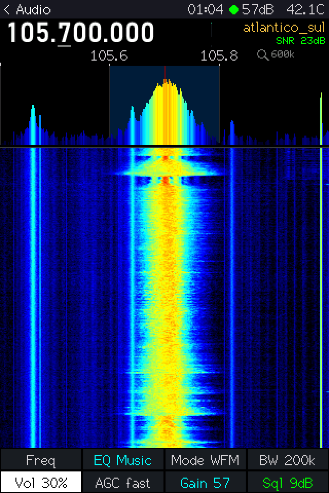
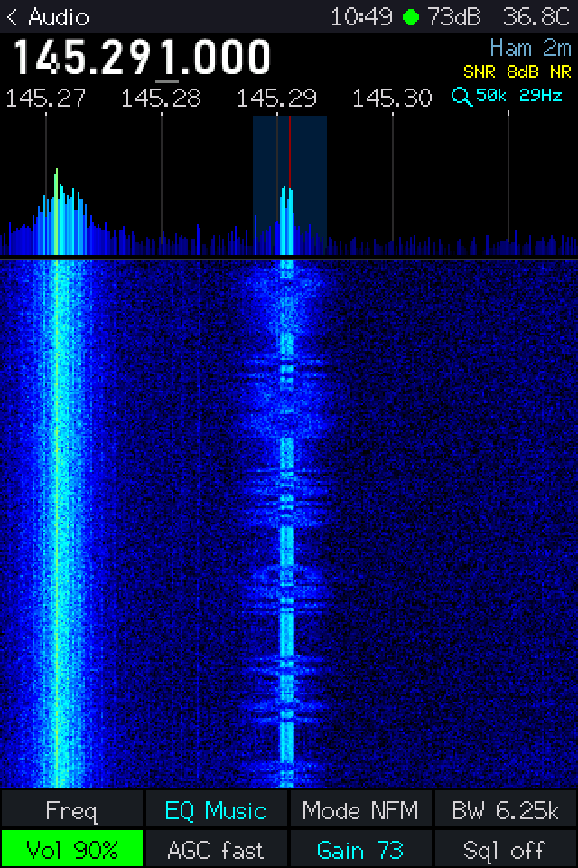
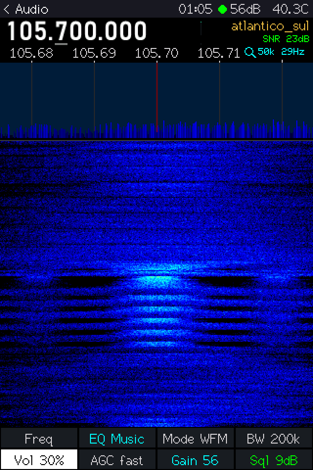
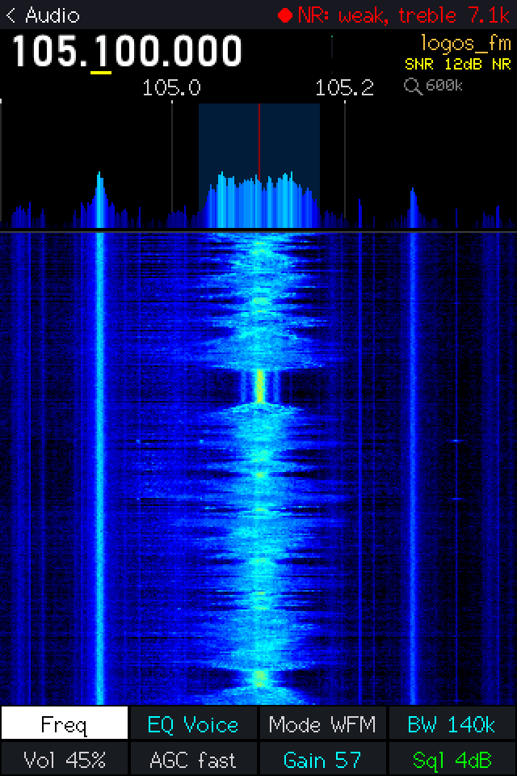
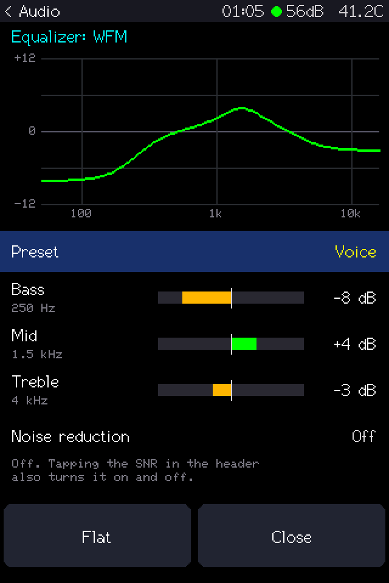
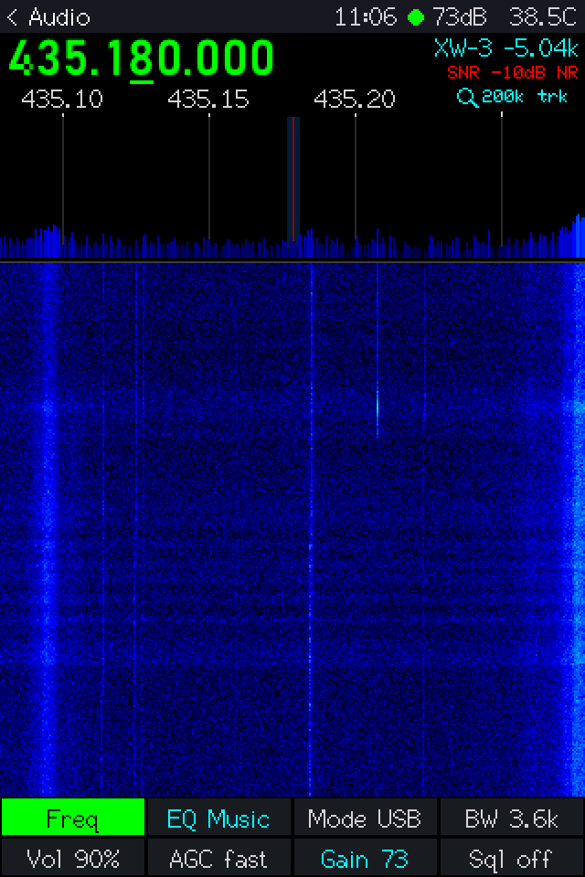

# Audio

[← Back to README](../../README.md)

 

Listens to a frequency on the speaker, with a 600 kHz spectrum and a waterfall. Left: an FM
broadcast station in WFM, with the 200 kHz channel shaded and the SNR in green. Right: a voice
transmission on 2 m in NFM, with the 50 kHz zoom.

Bottom bar: **Freq**, **EQ**, **Mode**, **BW** (channel bandwidth), **Vol**, **AGC**, **Gain** and
**Sql** (squelch).

- **Modes**: AM, NFM, WFM, USB, LSB and CW.
- **Channel bandwidth** per mode, as in SDR++: AM 3–15 kHz, NFM 6.25–25 kHz, WFM 100–220 kHz, SSB
  1.8–3.6 kHz and CW 200–1500 Hz.
- **SNR** of the channel in the header, in green, yellow or red.
- **Squelch** on the channel SNR (1 to 30 dB). It takes into account the noise the speaker itself
  adds to the reception, so it does not open and close by itself.
- **Volume** and gain (AGC or manual).

## Zoom

Tap the scale to switch the top spectrum between 600, 200, 100 and 50 kHz. In the zoom, the fine RBW
(29–37 Hz per point) shows narrow carriers and beacons that are lost in the noise at 600 kHz. The
sound and the SNR do not change. The magnifier in the corner of the scale shows the span and the
RBW.

## Automatic noise reduction (NR)

Turned on and off by tapping the SNR in the header (or in the EQ window); the header then shows
"NR". The device measures the hiss in the audio itself and the channel SNR, finds the cause and
applies the remedy, saying what it did in the status bar ("NR: weak, treble 7.1k" above):

- **clean WFM signal** (SNR of 20 dB or more): removes nothing, so music keeps all its treble; it
  only keeps measuring the noise, to notice hiss from the station itself;
- **weak signal**: cuts the treble (in WFM, below 15 dB of SNR, like car radios), lowers the volume
  up to 6 dB below the threshold (soft mute) and, in WFM, narrows the channel;
- **strong signal on a narrow channel** (WFM): opens the channel to 200 kHz;
- **hiss with a good signal**: stronger spectral reduction;
- **steady whistle**: learns it and removes it;
- **off tune** (FM): retunes onto the carrier;
- **voice** (NFM and AM): lets only 300–3400 Hz through.

The spectral reduction is the one used in amateur SDR radios (UHSDR/mcHF): noise estimate from the
speech presence probability, MMSE gain and smoothing against "musical noise". The volume the
reduction takes away along with the noise is given back (up to +6 dB, measured only where there is
signal, with a limiter against clipping). Delay of 21 ms; recordings keep the original sound.

## Equalizer

Presets (Flat, Voice, Music, Bass+, Treble+) and bass, mid and treble adjustment (±12 dB), kept per
mode. The curve shows the response. The same window turns the noise reduction on and off and shows
what it is doing.

## Notch

The whistle of the recorded internal spurs that fall inside the channel is removed from the audio
automatically ([Settings > Internal spurs](settings.md)).

## Satellites and Doppler

Tuned to the frequency of a satellite that is passing (by hand or through **Listen** in
[Decode > Satellites](decode.md#satellites)), the device corrects the Doppler by itself, also in
USB, LSB and CW. The header shows the satellite and the current Doppler in cyan ("XW-3 −5.04k"
above). With the zoom, tapping the magnifier chooses:

- **trk** (tracking, cyan, the default): keeps the satellite still at the center, on its published
  frequency;
- **fix** (fixed, yellow): lets you see the Doppler curve moving across the waterfall.
