# Decode

[← Back to README](../../README.md)

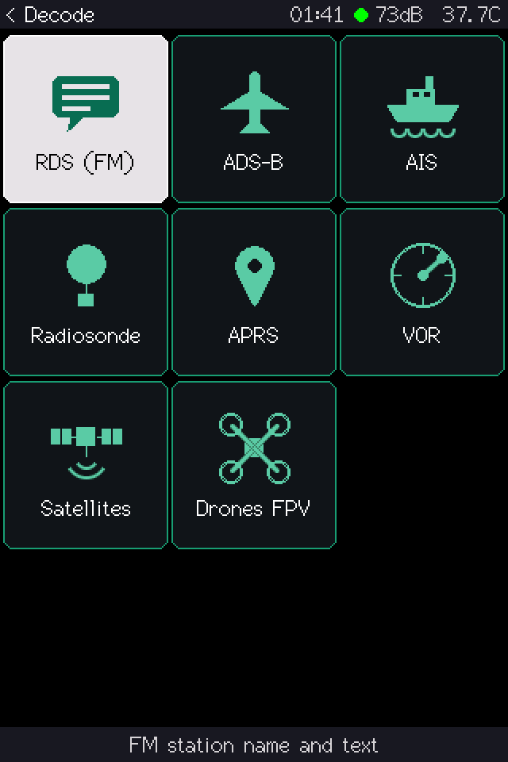

Opens a second icon menu with the decoders; the one used last is already selected, and
**< Decode** in each decoder's bar comes back here. Every decoder that shows positions has a
**list**, a **radar** (you at the center) and a **map** view (the radar over the `mundo.map` on the
card), plus an adjustable range (**Rng**) and your position (**Location**, typed once in decimal
degrees).

| Decoder | What it shows |
|---|---|
| [RDS](#rds) (FM stations) | Station name, text (song and program), program type, time (sets the device clock), reception quality |
| [ADS-B](#ads-b) (aircraft, 1090 MHz) | Callsign, altitude, speed, track, climb and descent, position, distance, **squawk**, **emergency alert** (7500, 7600, 7700 and the stated reason), autopilot selected altitude and heading, autopilot modes |
| [AIS](#ais) (ships, 162 MHz) | Name, type, speed, course, heading, size, draught, destination, ETA; shore stations, buoys and lighthouses; search and rescue alerts (SART, man overboard, EPIRB) |
| [Radiosonde](#radiosonde) (Vaisala RS41, 400–406 MHz) | Serial number, position, altitude, ascent, wind, temperature, approximate humidity, balloon burst and estimated landing point; automatic search of the band |
| [APRS](#aprs) (amateur, 145.570 MHz in Brazil) | Stations with position, course and speed, weather, objects, messages, Mic-E; packet log; frequencies for Brazil, USA, Europe and the ISS |
| [VOR](#vor) (aviation, 108–118 MHz) | Radial and course to the station on a compass rose, station identifier in Morse |
| [Satellites](#satellites) | Passes in the next 24 hours (when, direction, maximum elevation, whether it is visible to the eye), the sky with the pass path, distance and Doppler; **Listen** tunes to the right mode and bandwidth |
| [FPV drones](#fpv-drones) | Sweeps the 40 analog video channels at 5.8 GHz and warns of a steady carrier |
| [Radio astronomy](#radio-astronomy) (hydrogen line, 1420 MHz) | Hydrogen-line spectrum in km/s, total-power drift scans (Sun, Milky Way), where to point the dish, and maps of the galaxy built from your own measurements |

## RDS

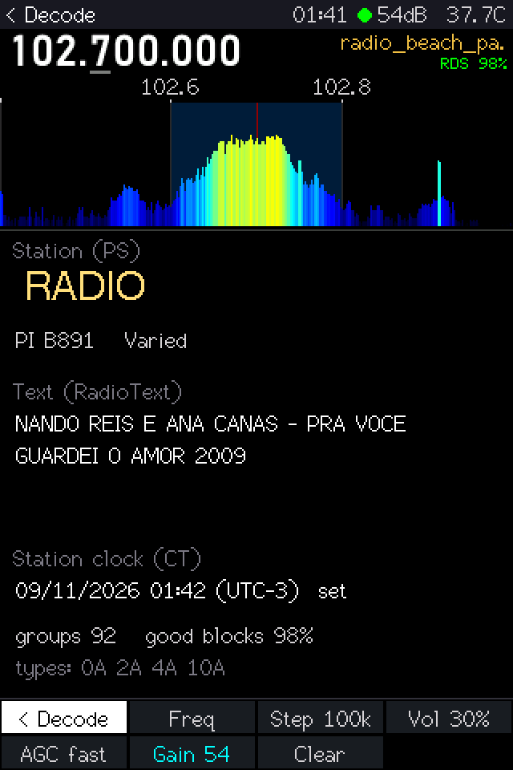

Top: frequency, scale and the 600 kHz spectrum with the 200 kHz channel (tap to tune). Below: the
station name (PS) in large letters, PI and program type, the RadioText, the station clock (CT) and
the percentage of good blocks. The sound plays along. Two consistent CTs set the device clock
([Settings > Date and time](settings.md)).

## ADS-B

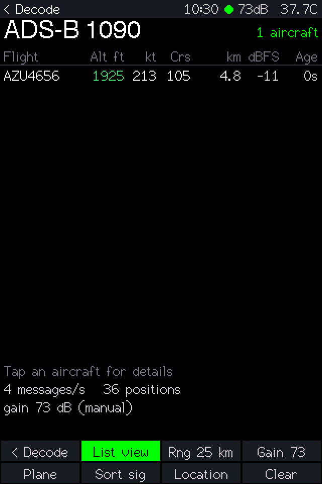 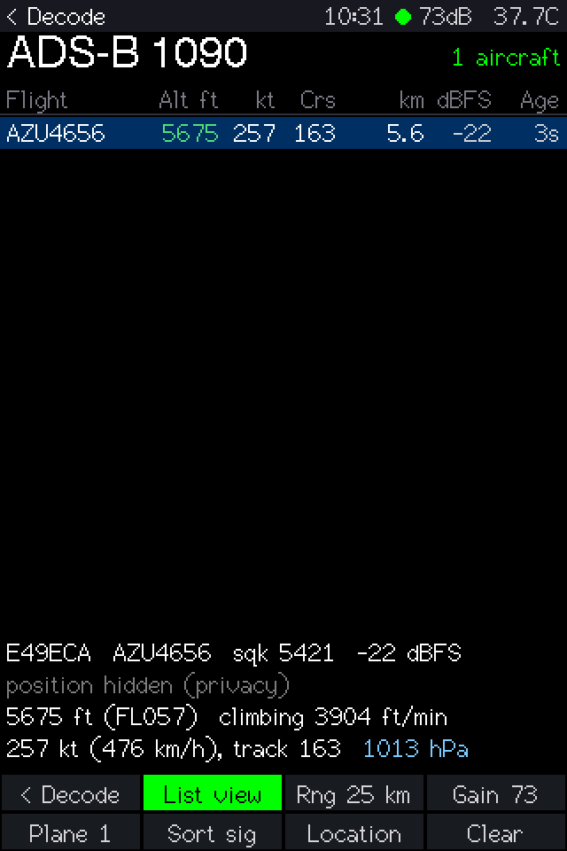

**List view**: callsign (or ICAO address), altitude in feet (green climbing, orange descending),
speed in knots, track, distance from you, signal in dBFS and age. **Sort** by signal, most recent or
distance. Tap an aircraft (or pick it with **Plane**) for the details (right): address, callsign,
squawk, autopilot modes, position, altitude and flight level, climb rate, speed in km/h, track,
altimeter setting (blue) and selected altitude/heading.

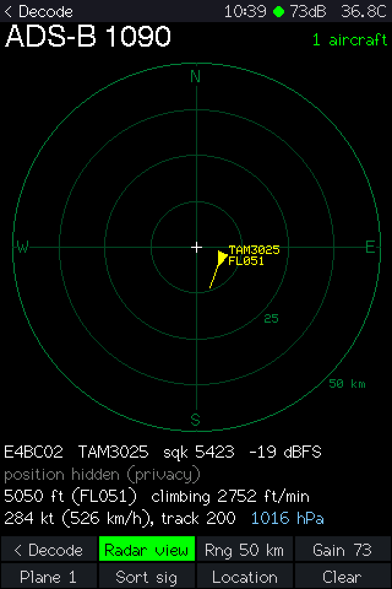 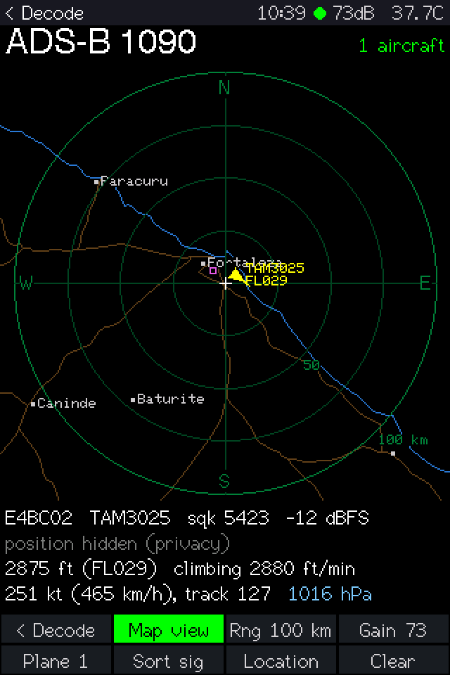

**Radar view** (left) and **Map view** (right): you at the center, north up, rings at 1/4 of the
range with the distances; each aircraft is a triangle pointing along its track, with a line for one
minute of flight and its callsign and flight level. Positions older than 15 s turn gray; aircraft
beyond the range show as a circle on the edge. In an **emergency**, the line, the aircraft and its
label turn red and the status bar says why.

The gain is always manual in ADS-B (the messages are 120 µs bursts and the AGC follows the average).

## AIS

Ships on the two AIS channels (161.975 and 162.025 MHz): **list** (name colored by ship type, type,
knots, course, km, age), **radar** and **map** (a long triangle along the course or heading with a
line for 6 minutes of travel; moored = circle; shore station = square; buoy = diamond; SART = circle
with a red X), 4 lines of details. Colors as on marine traffic sites (cargo green, tanker red,
passenger blue, fishing salmon, tug/pilot cyan, pleasure magenta, high speed yellow).

*Screenshot pending: no ships within reach where the prototype was tested.*

## Radiosonde

Vaisala RS41 weather balloons: **data view** (frequency and spectrum on top, tap to tune; serial,
battery, altitude, ascent, wind, satellites, position, distance and bearing from you, temperature,
approximate humidity, estimated landing, frame, offset, GPS time, error correction, SNR), **radar**
and **map** (green balloon going up, orange coming down, gray when lost for 60 s; magenta X at the
landing point). **Search** sweeps 400–406 MHz and shows the strongest peak; tap to listen there. The
sonde's GPS time sets the clock if nothing else has.

*Screenshot pending: needs a launch within reach.*

## APRS

Decodes APRS packets (1200 baud AFSK) on the chosen frequency (Brazil 145.570, USA 144.390, Europe
144.800, ISS 145.825): **list** of stations (colored by type, type from the symbol, km, path "direct"
or digipeater, age), **packets** (TNC2 log, newest on top), **radar** and **map** (moving = arrow
along the course, fixed = square, digipeater/iGate = diamond, weather = circle, aircraft/balloon =
triangle, object = X). **Sound** plays the channel on the speaker. Packets also go to the serial
port.

*Screenshot pending: no APRS traffic where the prototype was tested.*

## VOR

Top: frequency, scale and spectrum (tap to tune on the 50 kHz grid, 108–117.95 MHz). Below: a compass
rose with the station at the center and you at the end of the radial, the magnetic radial, the
course to fly to the station, its spread, and the station identifier decoded from its Morse code.
**Sound** is off by default (the subcarrier whistles).

*Screenshot pending: needs a VOR within reach.*

## Satellites

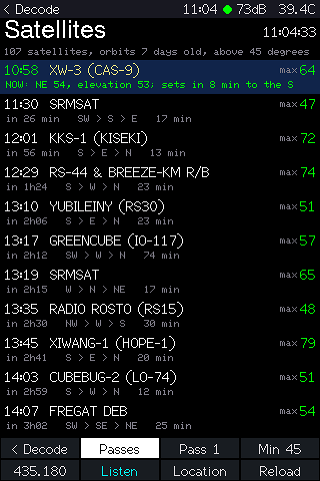 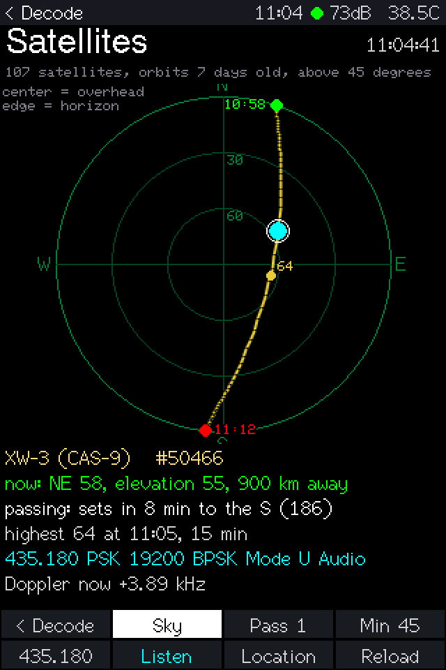

From the orbits on the card (`/sat`), your position and the clock: the passes in the next 24 hours
above a minimum elevation (**Min**).

- **Passes** (left): local time, name and maximum elevation (colored); below, how long until it
  rises, the direction it crosses the sky (e.g. "SW > S > E"), the duration and whether it is visible
  to the eye. A satellite passing now shows in green with where it is and when it sets.
- **Sky** (right): rings at 0/30/60° elevation, the path of the chosen pass with its rise and set
  times and highest point, the satellite now (cyan), and below: direction and distance now, when it
  rises and sets, frequency, mode and the Doppler right now.
- **Listen** tunes [Audio](audio.md) to the satellite's frequency, mode and bandwidth (APRS on the
  ISS opens the APRS decoder), and the Doppler is corrected by itself while it passes.
- **Reload** reads the orbits again after you update them; the header says how old they are.

## FPV drones

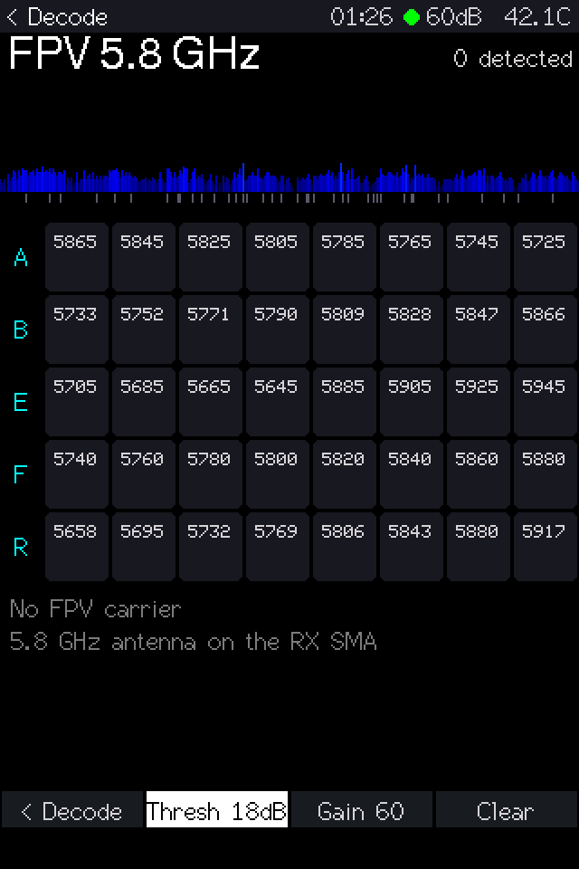

Sweeps the 40 analog video channels at 5.8 GHz (bands A, B, E, F, R, 5645–5945 MHz) and warns when it
finds a steady carrier (a channel lit in 6 of the last 8 sweeps; WiFi bursts don't count). Each cell
shows the channel's frequency and how many dB it is above the noise; the detected ones turn red and
are listed below. **Thresh** sets the detection level. It only detects, it does not show the video.

It needs a 5.8 GHz antenna; in this band the Pluto's chip is out of specification and its
sensitivity is low.

## Radio astronomy

Listens to the **21 cm hydrogen line (1420.406 MHz)** from the Milky Way and to the Sun as a
"radiometer". It needs a dish (an old 1.5–1.9 m C-band TV dish works), a low-noise amplifier at the
feed and a 1420 MHz SAW filter after it (LNA → SAW → Pluto). With the short telescopic antenna it only
shows the device's own noise.

The Pluto alternates its tuning between two frequencies a few hundred kHz apart (frequency switching)
and integrates every sample on its second core; the ESP32 folds the two halves, which cancels the
receiver's own ripple and drift. Gain is fixed (no AGC) during a measurement, and the device does not
touch the SD card while integrating (the card's SPI clock has a harmonic at exactly 1420.000 MHz).

Views (**View**):

| View | What it shows |
|---|---|
| **Spectrum** | The hydrogen line in km/s (corrected to the local standard of rest), in % of the system temperature, with a robust baseline; narrow internal spurs are marked and left out |
| **Power** | Total power over time for each tuning: a drift scan of the Sun or of the galactic plane passing through the beam |
| **Sky** | Where to point: the sky from your location now, the Milky Way, the Sun's path, the geostationary arc (where a parked TV dish already points), radio sources (Cas A, Cyg A, Tau A, Sgr A...) and the beam. Tap the sky to aim there |
| **HI map** | Your saved measurements on a map of the galaxy (intensity, velocity, peak or coverage), the beam's path in the next 24 h, and the profile of the selected measurement |
| **Galaxy** | Longitude–velocity diagram, the galaxy seen from above (kinematic distances) and the rotation curve, all computed from your measurements |

**Plan** chooses the measurement: HI wide (±210 km/s), HI fine (±84 km/s) or total power. **Save**
writes the spectrum and the power log to `/ra` on the card and adds the measurement to the map
(`/ra/himap.bin`).

The images below are **previews** drawn on the PC by the same drawing code with a simulated galaxy
(the first one with the screen's status bar, header and buttons, as on the device); real measurements
are waiting for the dish, LNA and filter.

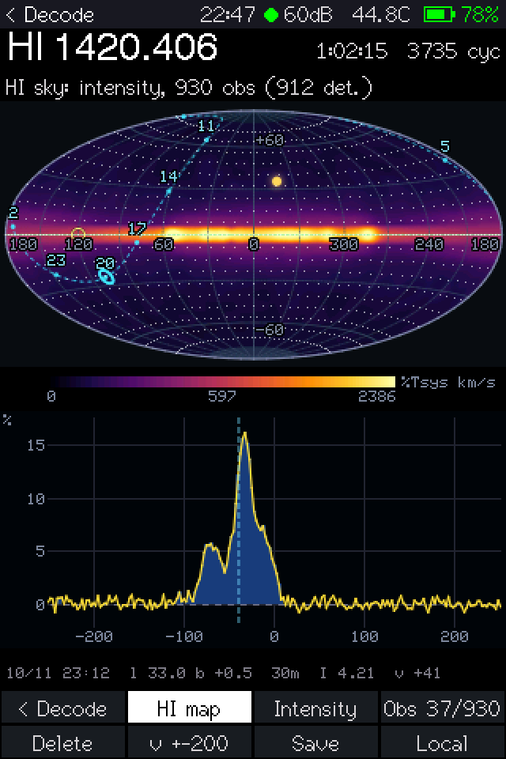 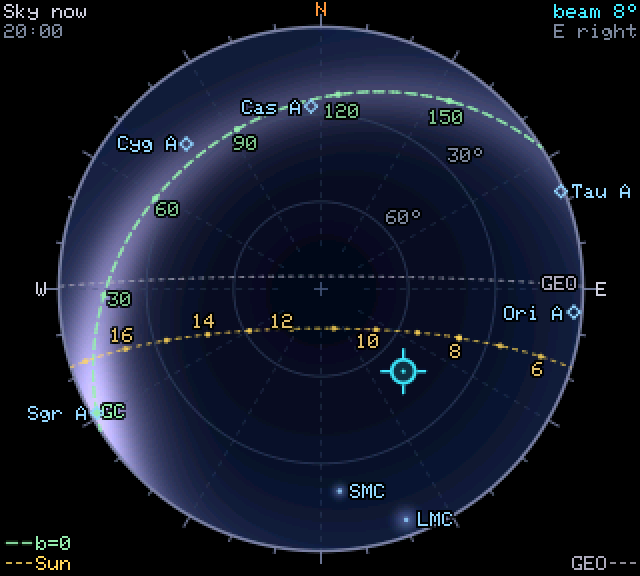

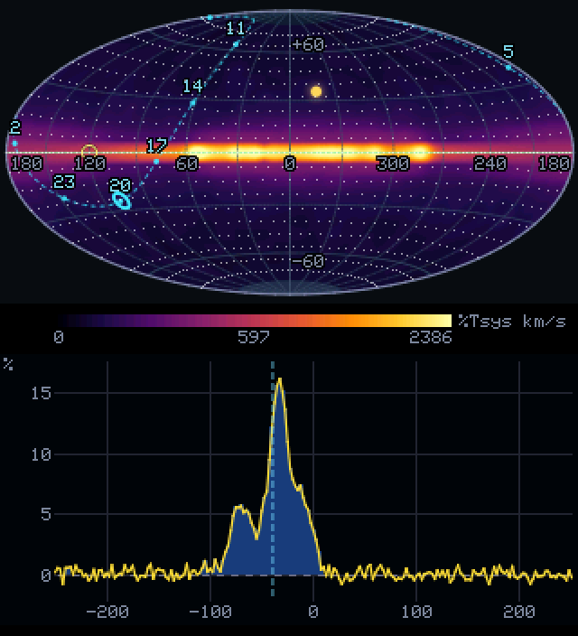

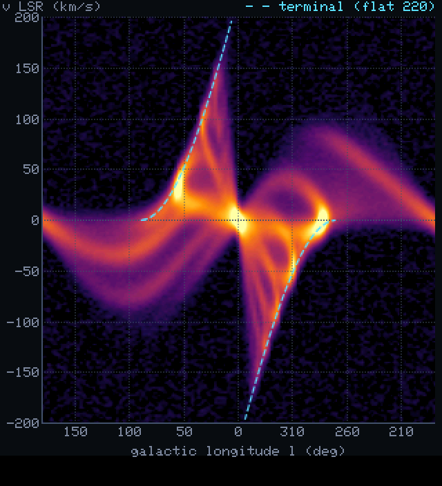 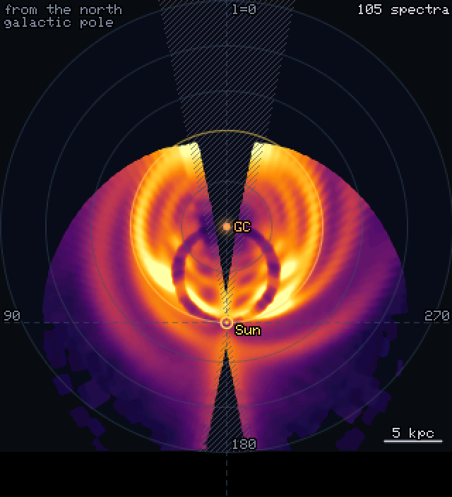
