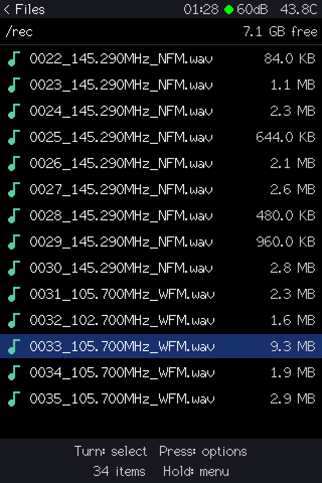
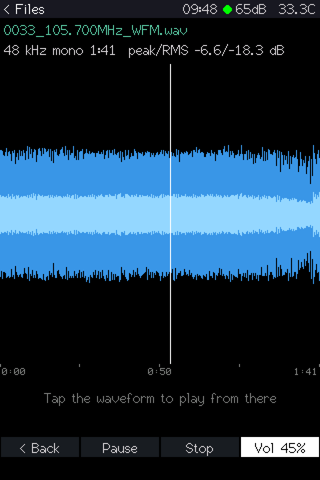

# Files

[← Back to README](../../README.md)

 

Browses the SD card (left: the `/rec` folder with recordings): enter folders, create, rename, move
and delete (with confirmation), and **play WAV files** (any 16-bit PCM WAV, 8 to 96 kHz, mono or
stereo) with pause, ±10 s, volume and equalizer. Pressing an item opens its options.

**Waveform** (in a WAV file's menu, right): the waveform of the whole file (dark blue = min/max,
light blue = RMS), with sample rate, channels, length, and peak and RMS level in dB. Long files appear
bit by bit with the percentage read. Tap the waveform to play from that point; a cursor follows the
playback.
