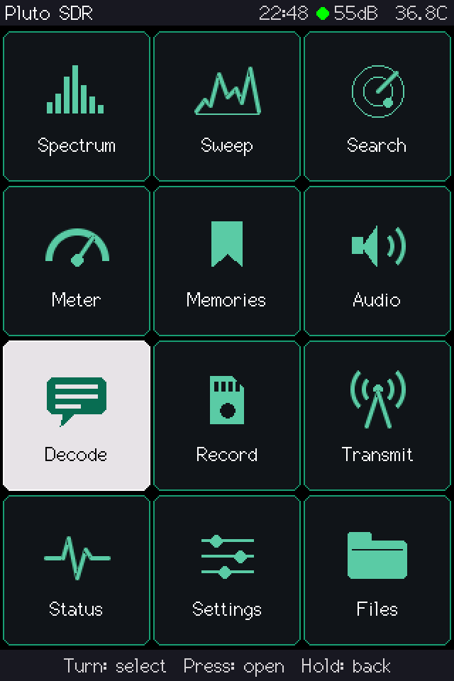
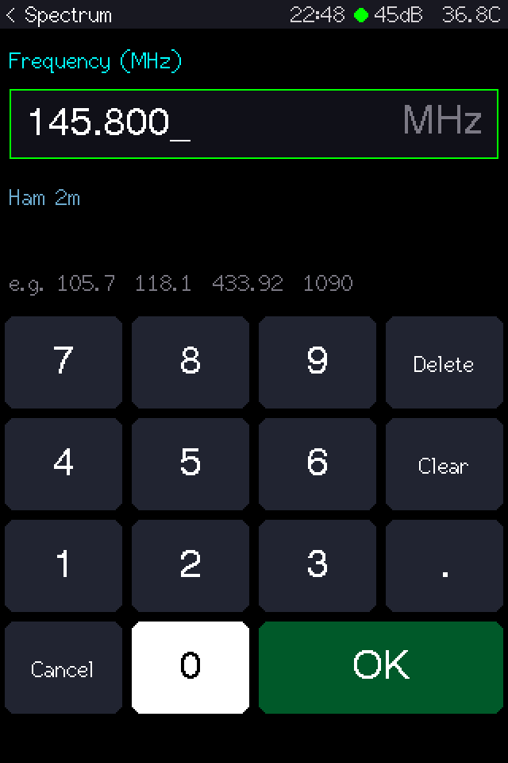
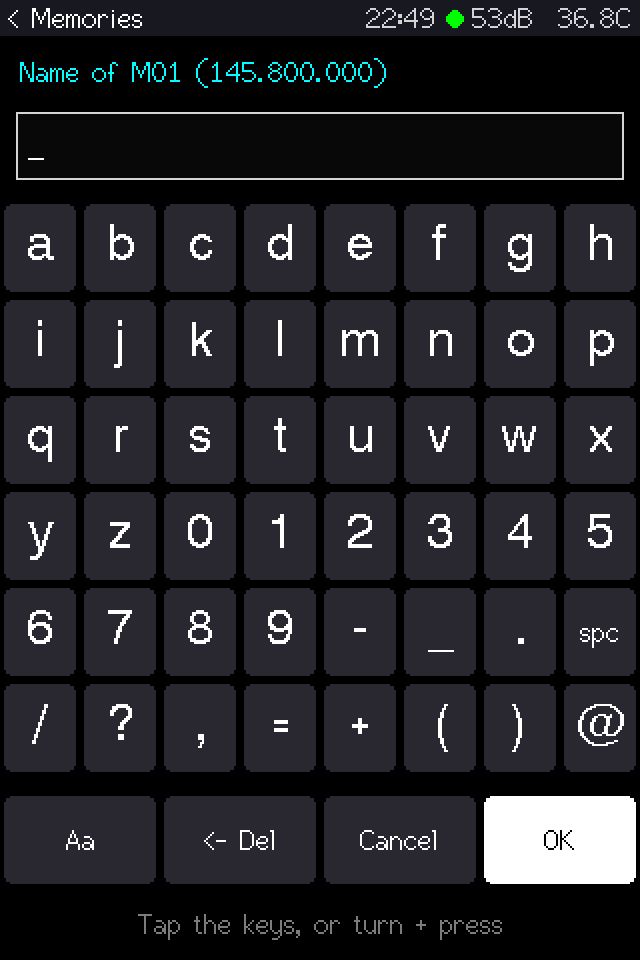

# Everywhere on the device

[← Back to README](../../README.md)

The home menu is a grid of icons: turn the encoder to select and press to open, or tap the icon.
In any app, **holding the button** (0.6 s) or tapping the "<" in the status bar goes back to the menu.

## Status bar

At the top of every screen: the app title, whether the Pluto is connected, the RX gain, the radio
chip temperature, the time (once the clock is set), the battery in % (smoothed over ~2 minutes; it only goes down, and goes up only while charging) and a padlock when the touch
screen is locked. Messages (errors, notices) show there for a few seconds.

## Touch and encoder

- **Touch lock**: holding the button for 2 s locks and unlocks the touch screen (the encoder keeps
  working).
- **Dim when idle**: after a while without use the screen dims. The first touch or turn only wakes it. With the **Power saver** on
  ([Settings](settings.md#power-saver)) the screen turns off completely after 30 s.
- **Gestures**: a tap tunes (on the current step); a horizontal drag tunes little by little; a long
  touch on the spectrum or the waterfall saves that frequency as a memory.
- **Bottom bar**: turn the encoder to pick a cell, press to edit it (green), turn to change the
  value. Tapping a cell does the same.

## Typing a frequency and a name

 

- **Frequency keypad**: tap the big number in the header and type in MHz. The band you are typing
  into shows live; frequencies outside 70 MHz–6 GHz are refused.
- **Text keyboard**: for memory names, file names, the callsign and CW messages. Tap the keys, or
  turn the encoder and press.

## Header

- **Name in the header**: the name of the memory (yellow) or band (blue) you are on, like "FM",
  "Aviation", "Ham 2m", "AIS" or "PMR446".
- **Step by band**: entering a band switches the step to that band's (FM 100 kHz, aviation 25 kHz,
  2 m 5 kHz, 70 cm 12.5 kHz...). Inside the band, a step you choose by hand stays.

## Screenshots

Like the Mayhem firmware: **hold a finger on the status bar** (~0.7 s) and the exact screen is saved
as a PNG on the card, in `/screenshots` (`0001_Audio.png`, with the app name). From a PC: with a
cable on the ESP32's right USB-C, send `screenshot` over the serial port (115200 baud; the Arduino IDE
serial monitor works). The picture is taken at once; compressing and writing happen bit by bit,
without stopping the audio. During an audio recording, the picture waits and goes to the card when
the recording ends.

All the screenshots in this documentation were taken this way.

## Everything is saved

Memories, settings and calibrations are saved in flash and can be backed up to the card
([Settings](settings.md)). The device starts with an animated logo screen.
