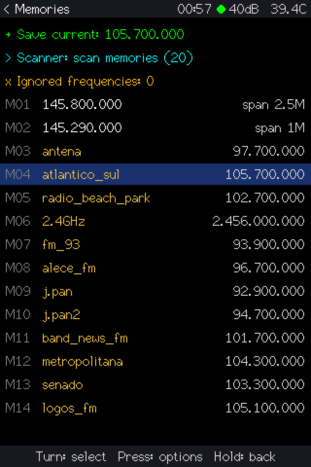
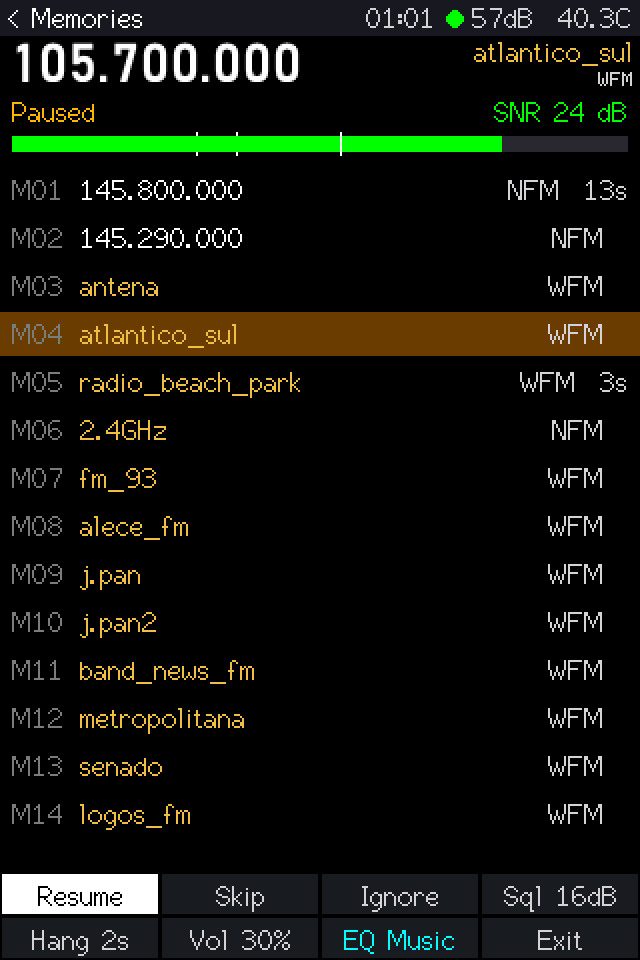
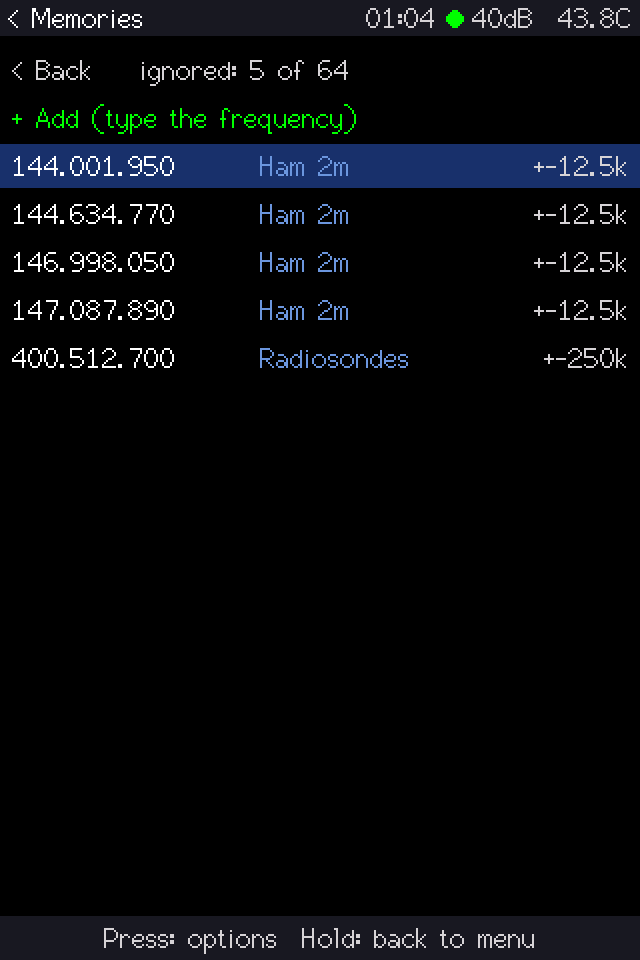

# Memories

[← Back to README](../../README.md)

Keeps up to 20 frequencies with names.

- **Save current** asks for a name; a long touch on the spectrum or the waterfall of the Spectrum
  and Audio apps does the same.
- Pressing a memory opens its options: tune, rename, delete.
- The memory name shows in the header whenever you are on that frequency.

## Scanner

Goes through the memories, stops on those with a signal (by the channel SNR, with an adjustable
squelch, **Sql**), waits a while after the signal ends (**Hang**) and moves on.

- **Pause/Resume**, **Skip**, **Ignore** a memory, or tap a channel to stay on it.
- Each memory's mode comes from its band: WFM from 76 to 108 MHz, AM on aviation, NFM elsewhere.
- Memories on the ignore list are left out; holding a finger on a channel adds it to the list.
- The bar under the frequency shows the channel SNR and the squelch level; each line shows the mode
  and how long ago it had a signal.

## Ignored frequencies

Up to 64 frequencies that the [Search](search.md) hides and the scanner skips, each with a width
(±2.5 kHz to ±250 kHz; the default follows the band). Add them by typing, by holding a finger on a
Search signal or on a scanner channel; change the width and remove them on the list itself. They go
into the settings backup.
