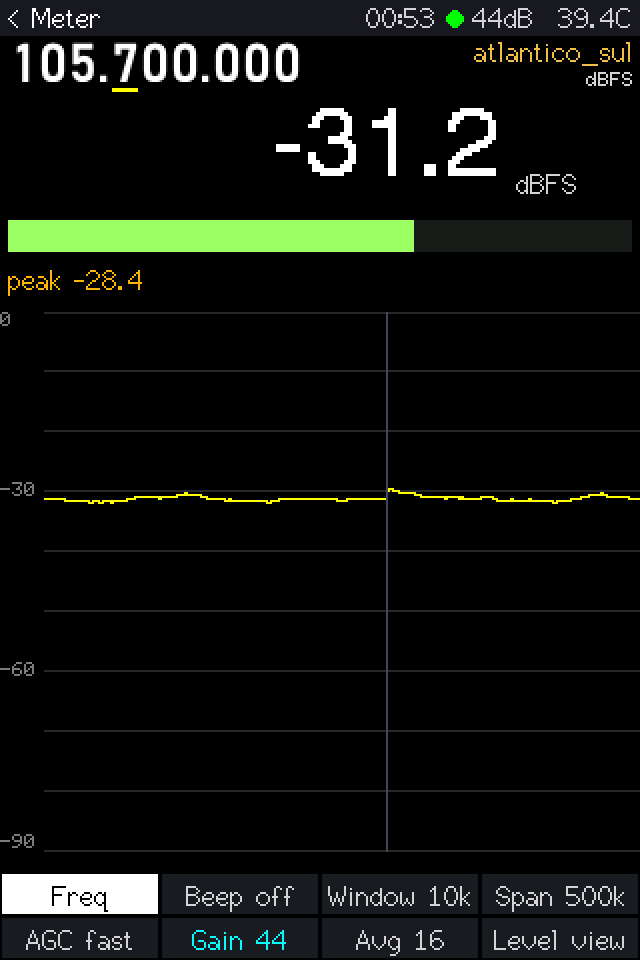
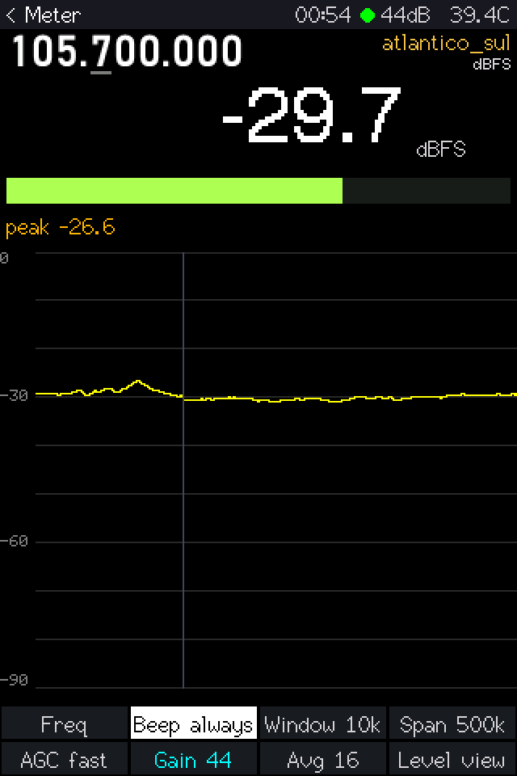
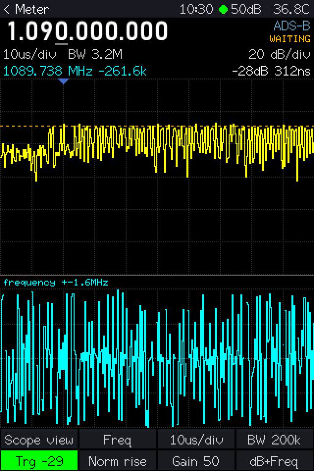
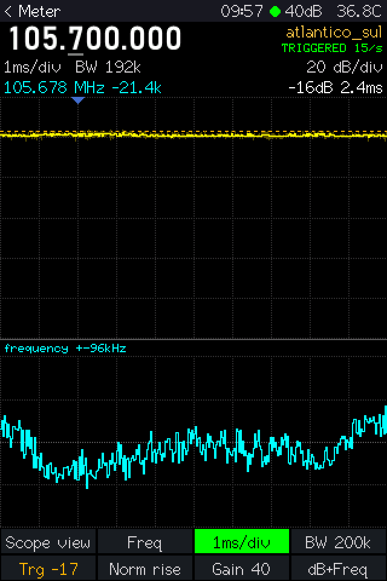

# Meter

[← Back to README](../../README.md)

## Level view

 

Signal level at the center of the tuning, in dBFS: the current value, the peak and a scrolling graph.
The average (**Avg**) can be of 1, 4 or 16 readings, over a **Window** around the center. Tap the
number or the peak to reset the peak.

**Beep** (fox hunting, right): the speaker beeps with a pitch and a rate that rise with the level
(400 to 2600 Hz, from one beep every 0.6 s to one every 0.15 s, over a 60 dB scale), to find a source
by walking with the device without looking at the screen. It can be off, **always** on or only
**above a threshold** (−85 to −10 dBFS). The sound lags the signal by about 0.2 s. The speaker costs
a little reception (2–3 dB); for weak signals, use the threshold. The volume is the Audio app's.

## RF oscilloscope

 

The **Scope view** cell switches to an RF oscilloscope: the signal's amplitude over time, to see
pulses, bursts and modulation.

- **Time base** from 1 µs to 500 ms per division; **bandwidth** (**BW**) from 12.5 kHz to 56 MHz.
- **Y axis** in dB, linear, frequency, or dB + frequency (right: an FM station, amplitude on top and
  the frequency deviation below).
- **Trigger** Auto, Normal or Single, on the rising or falling edge, with an adjustable level
  (**Trg**; tapping the graph puts the trigger there).
- Long time bases scroll like a chart recorder.
- On each trigger the **pulse frequency** shows (with the offset from the tuning), with its level and
  length; tapping that line tunes to the pulse.

Left: an aircraft's ADS-B reply at 1090 MHz, 10 µs per division, Normal trigger on the rising edge:
the level jumps at the trigger and stays high for the whole message.
