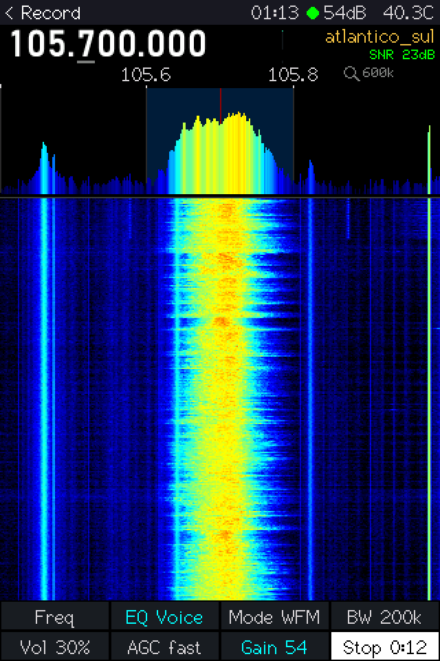

# Record

[← Back to README](../../README.md)

The same screen as [Audio](audio.md), with a **Record** button. It records WAV files (48 kHz, mono,
16-bit, about 5.6 MB per minute) to `/rec` on the card, with the frequency and the mode in the file
name (`0033_105.700MHz_WFM.wav`). While recording, the button shows **Stop** and the elapsed time.

- The recording keeps the original sound, before the volume, the equalizer and the noise reduction.
- Leaving the app stops and saves the file.
- The file is updated every 5 s, so a power cut loses only the last seconds.
- Recordings can be played and viewed in [Files](files.md).
