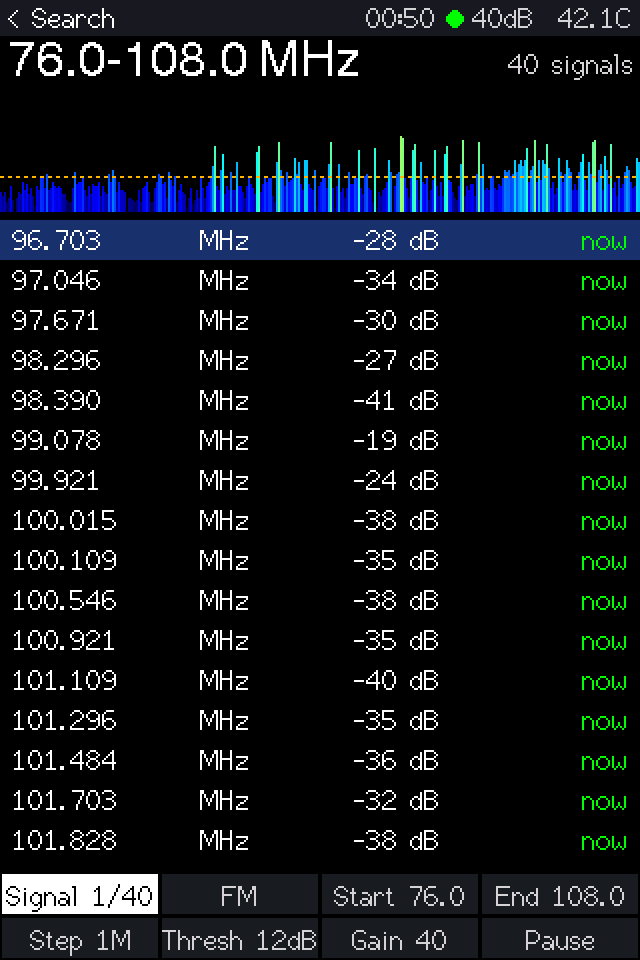
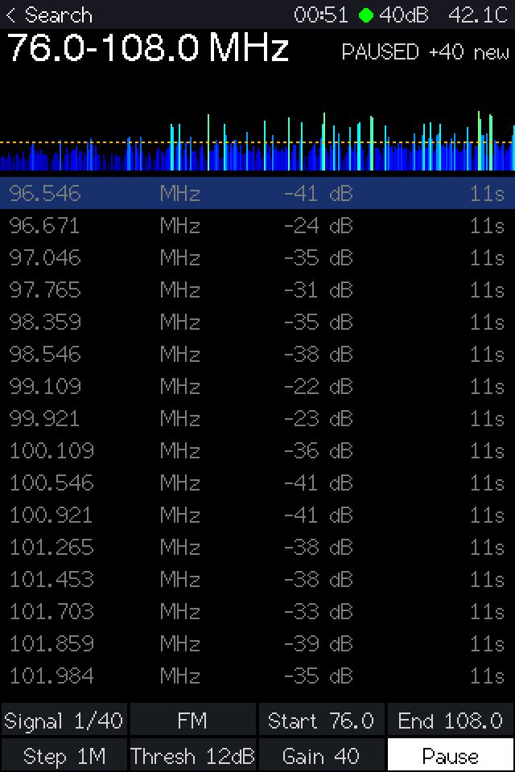

# Search

[← Back to README](../../README.md)

 

Sweeps a band and lists the signals above a threshold (**Thresh**): peak frequency, level and how
long ago they were last seen. Signals leave the list after 2 minutes without showing up. Tap a
signal to open the [Spectrum](spectrum.md) on it. Recorded internal spurs can show marked ("int") or
hidden.

The list does not jump around: it only reorders and adds new signals when it is not paused and you
are not choosing a signal with the encoder (3 s after the last turn); otherwise the lines stay in
place and only the level and age change.

- **Pause** freezes the list (the sweep keeps going; the header shows "PAUSED +N new"); **Resume**
  shows everything (right screenshot).
- **Hold a finger on a signal** to put it on the ignore list ([Memories](memories.md)).
- **Hold a finger on the header** to clear the list.
