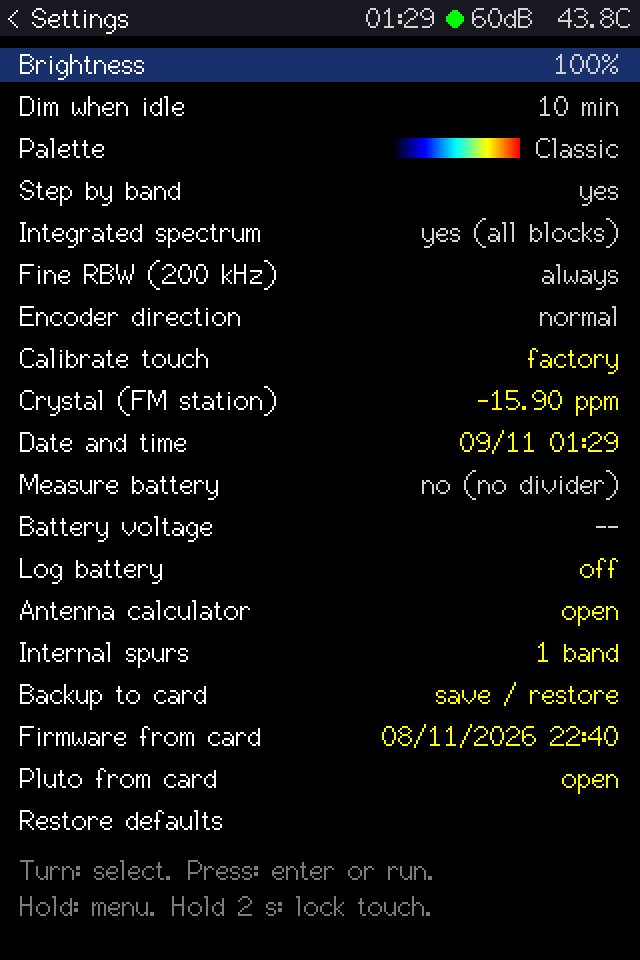
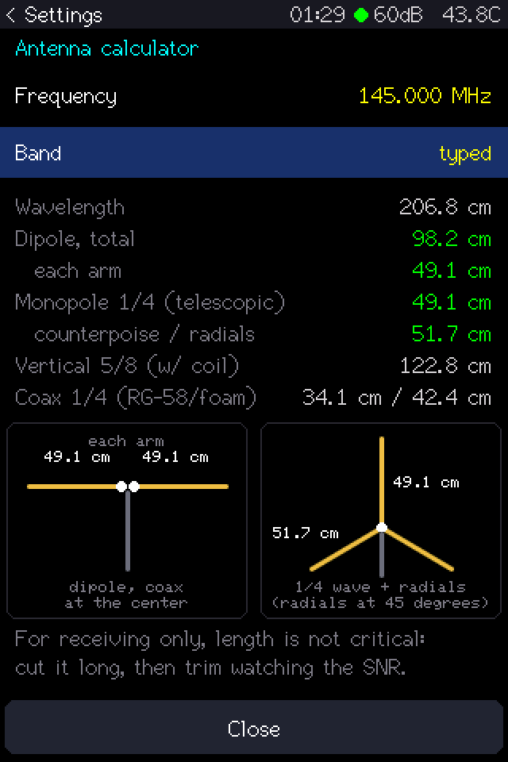
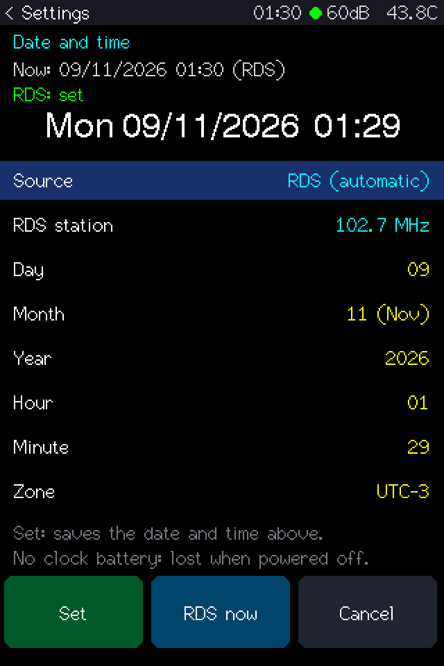
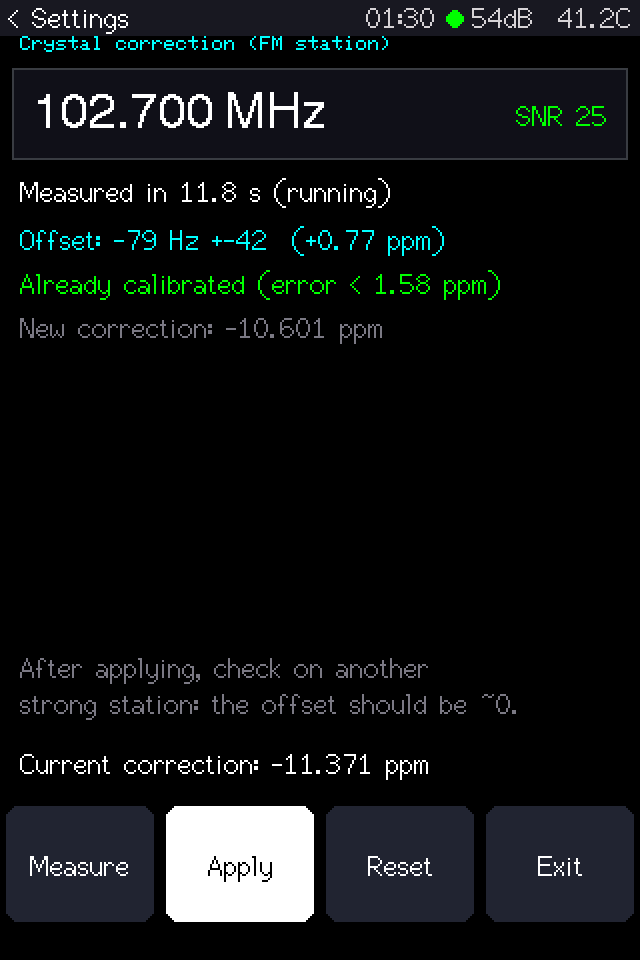
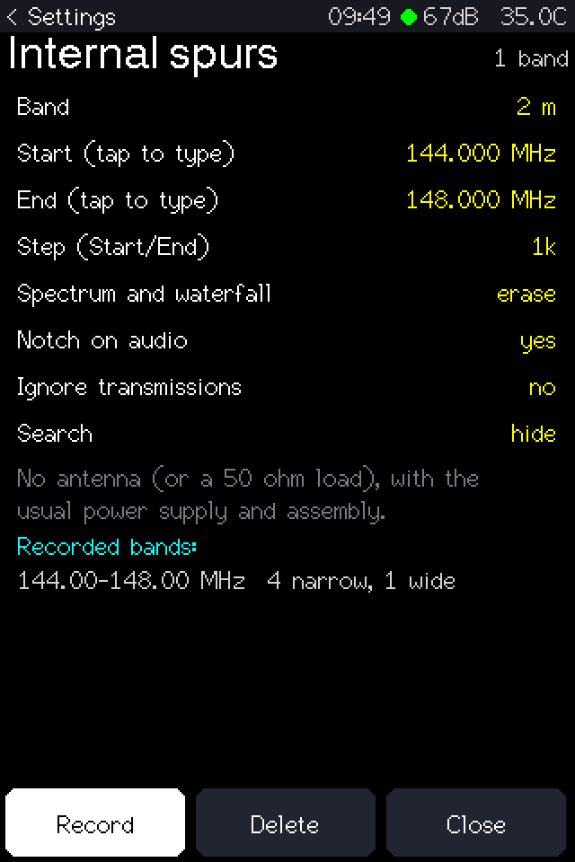
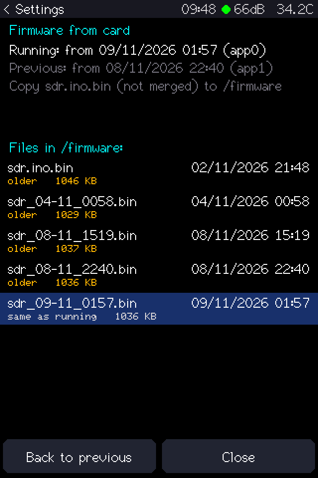
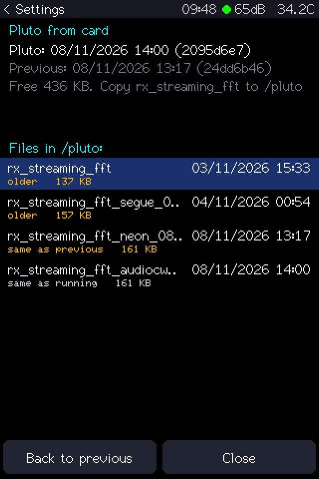
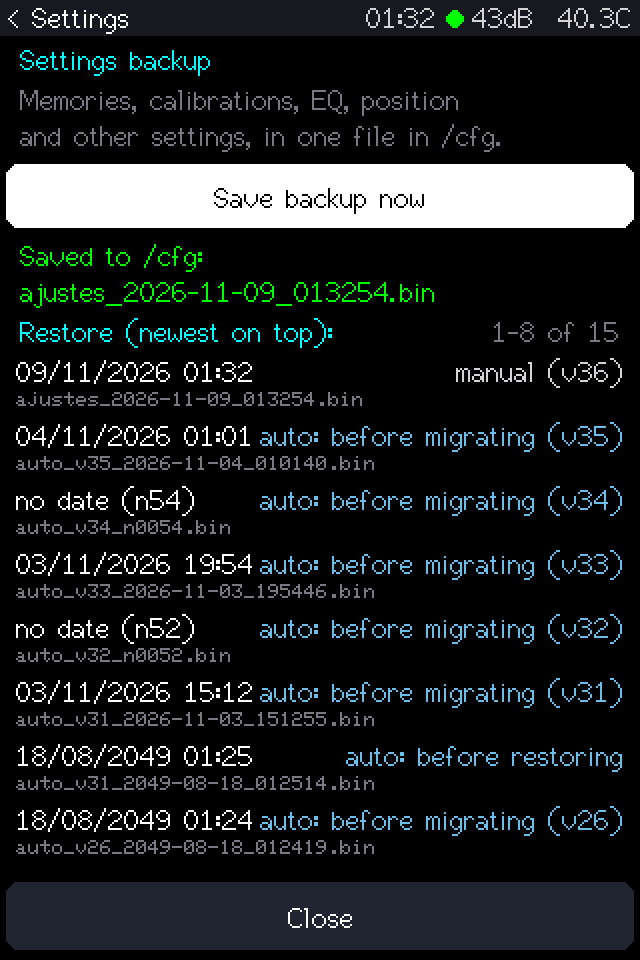

# Settings

[← Back to README](../../README.md)

| Setting | What it does |
|---|---|
| Brightness | Screen brightness |
| Dim when idle | Never, 30 s, 1, 2, 5 or 10 min |
| Palette | Waterfall colors: Classic, Turbo, Fire, Gray (with a sample) |
| Step by band | Turns the automatic step on entering a band on or off |
| Integrated spectrum | Average of all the FFTs on the Pluto (yes) or one block per line (no) |
| Fine RBW (200 kHz) | On the 200 kHz span: auto (only 110 MHz–2 GHz), always or never. Below 200 kHz it is always on. "Pluto has no fine RBW" = the Pluto program is older |
| Encoder direction | Reverses the turning direction |
| Calibrate touch | Tap the corners shown |
| Crystal (FM station) | Measures the Pluto's frequency error on a strong FM station and corrects it |
| Date and time | Source (RDS automatic or manual), RDS station, time zone, manual setting |
| Measure battery | Turns on the battery reading (needs the divider fitted) |
| Battery voltage | Fine adjustment to match the multimeter |
| Log battery | Writes the discharge to `/bat` on the card (CSV every 30 s, with the filtered and the raw reading) |
| Antenna calculator | Dipole, monopole, 5/8, radial and λ/4 coax lengths for any frequency, with drawings |
| Internal spurs | Records, with no antenna, the spurs the device makes itself, per band; they then vanish from the spectrum and the audio |
| Backup to card | Saves and restores the settings in `/cfg` |
| Firmware from card | Updates the firmware from `/firmware` and goes back to the previous one |
| Pluto from card | Sends the Pluto program from `/pluto` over the data cable |
| Restore defaults | Resets the settings (keeps the touch calibration, position, clock and crystal) |

## Antenna calculator

For any frequency (turn, or tap to type) or a ready band (current radio frequency, FM, VOR, 2 m/APRS,
AIS, 433, 70 cm, ADS-B): wavelength, dipole total length and each arm, 1/4 monopole and its
counterpoise/radials, 5/8 vertical, and a 1/4 coax transformer (RG-58 and foam), with drawings of the
dipole and the monopole. For receiving the length is not critical: cut it long, then trim it while
watching the SNR.

## Date and time

**Source**: RDS (automatic) or manual. With RDS, the clock sets itself from the time sent by the FM
station chosen in **RDS station** while you are on the home menu, and the line under the title says
how it is going ("set", "the station sends a wrong date"...). **RDS now** tries right away. **Day**,
**Month**, **Year**, **Hour**, **Minute** and **Zone** set it by hand (**Set**). There is no clock
battery: the time is lost when the device is off, and RDS sets it again.

## Crystal (FM station)

The average of an FM station's demodulated audio is its carrier offset from the tuning. **Measure**
on a strong station (SNR of 15 dB or more), wait for the uncertainty to fall, and **Apply**: the
correction goes to the Pluto and is measured again (it should drop to about 0, "Already calibrated").
**Reset** removes it. The correction is kept and sent to the Pluto at every connection.

## Internal spurs

The device's own electronics make narrow spurs that show in the spectrum and whistle in the audio.
With **no antenna** (or a 50 Ω load) and the usual power supply and assembly, choose a **Band** (or
**Start**/**End**/**Step**) and **Record**: the device sweeps it 6 times and keeps only what is
always there. Then:

- **Spectrum and waterfall**: nothing, mark, or **erase** them (the default);
- **Notch on audio**: removes their whistle from the sound;
- **Ignore transmissions**: leaves out blocks as wide as a WFM/NFM station (stations leaking in
  without an antenna);
- **Search**: show, mark or hide them.

The recorded bands are listed with how many narrow and wide spurs they have. Record them again
whenever the assembly or the power supply changes.

## Firmware from card

Lists the `.bin` files in `/firmware` with their date and whether each is newer, older or the same as
the running one, and shows the firmware running now and the previous one. Pick a file and confirm:
the ESP32 checks the whole image before switching (a failure halfway keeps the current firmware) and
restarts. **Back to previous** switches back.

## Pluto from card

Shows the Pluto program running now (date and md5), the previous one and the free space, and lists
`/pluto`. Sending a program: the ESP32 sends it over the data cable, the Pluto checks it, keeps the
running one as the previous, switches and restarts the program. The new program only **confirms**
after running 30 s and answering the ESP32; if it does not, the Pluto goes back to the previous one
by itself. **Back to previous** switches back. Details in [Pluto setup](../PLUTO_SETUP.md).

## Backup to card

**Save backup now** writes all the settings (memories, calibrations, EQ, position...) to one file in
`/cfg`. The list shows each backup with its date and version, manual or automatic (the device saves a
copy by itself before migrating the settings to a new firmware and before restoring). Pick one and
confirm to restore it; the ESP32 restarts with it.
