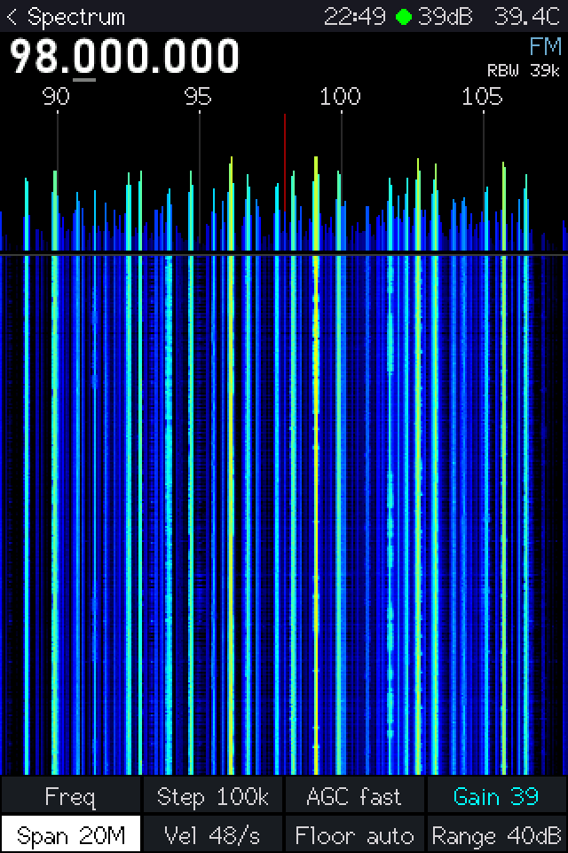
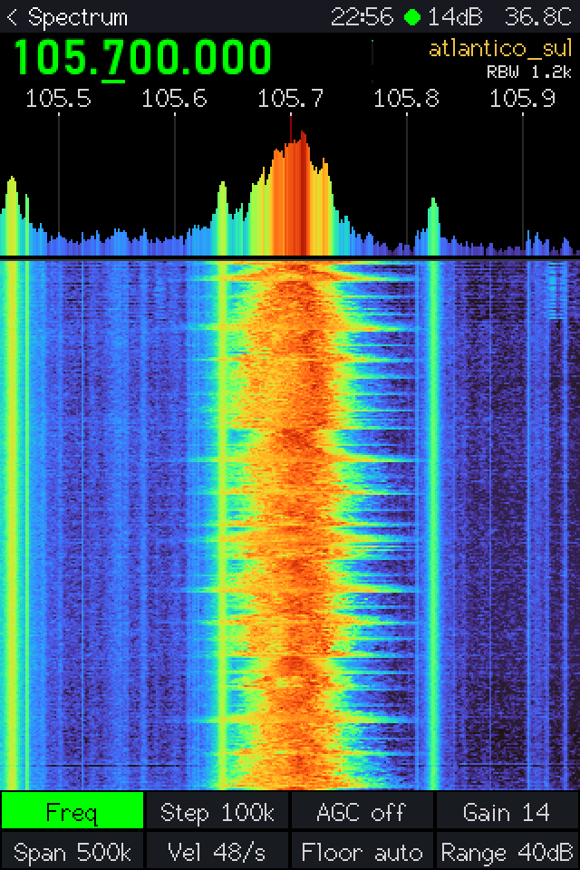
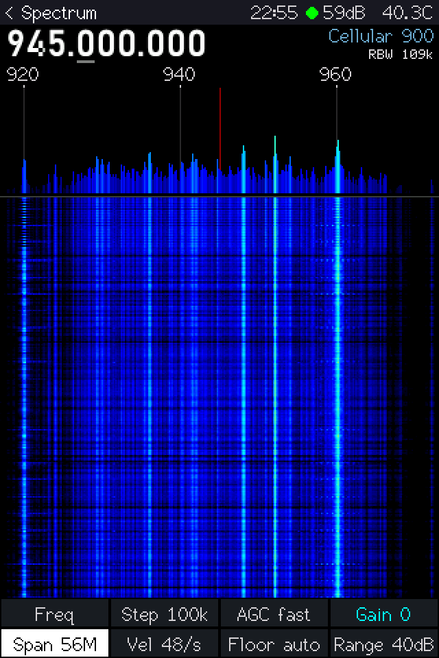
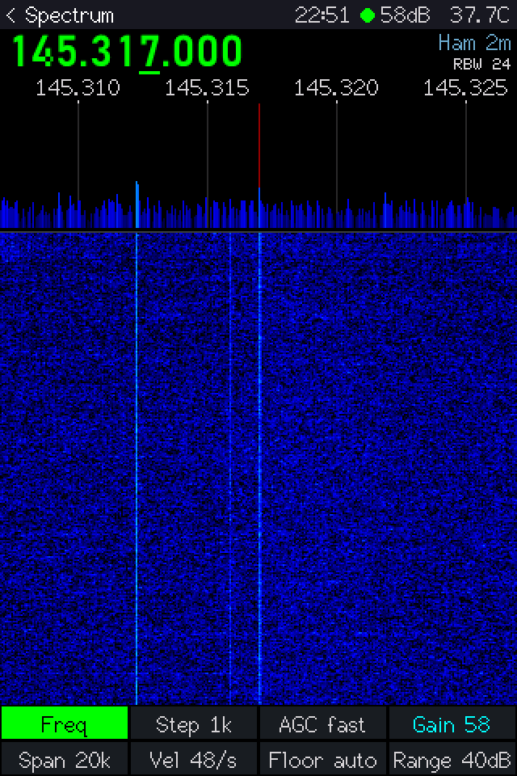
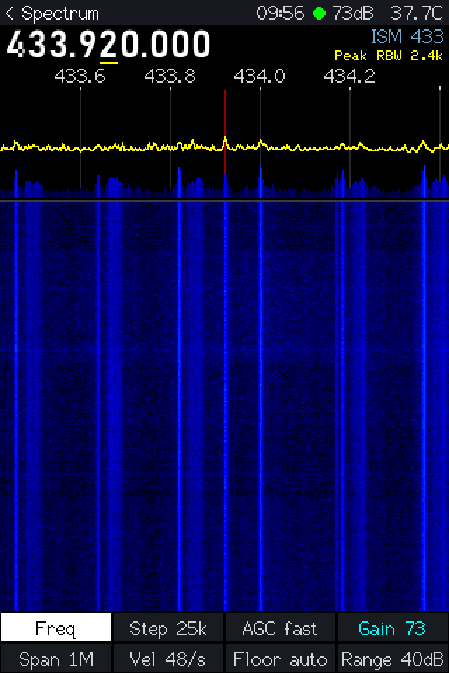

# Spectrum

[← Back to README](../../README.md)

 

Live spectrum and waterfall at 48 lines per second, from 70 MHz to 6 GHz. Left: the FM broadcast
band, 20 MHz wide. Right: one FM station, 500 kHz wide, with the Turbo palette and a memory name in
the header.

Bottom bar: **Freq**, **Step**, **AGC**, **Gain**, **Span**, **Vel** (waterfall speed), **Floor** and
**Range** (contrast).

## Span

From 10 kHz to 56 MHz.

The GSM 900 band with the 56 MHz span.

## Fine RBW

On spans from 10 to 200 kHz the Pluto filters and lowers the sample rate before the FFT and uses FFTs
of up to 8192 points, so each column resolves ~24–38 Hz instead of ~610 Hz. The noise per point drops
12–14 dB, and a weak carrier that is lost in the noise in normal mode shows up. Above: a 2 m signal
with a 20 kHz span and RBW 24 Hz (top right).

On spans from 10 to 100 kHz it is always on. On the 200 kHz span it follows **Settings > Fine RBW
(200 kHz)**: **auto** (only from 110 MHz to 2 GHz; the FM band and above 2 GHz keep the normal one),
always or never. The header shows the RBW in use. With it the scale goes from −120 to 0 dBFS, and
internal spurs are not erased (their maps were recorded at the normal resolution). It also works in
the [Meter](meter.md); in [Audio](audio.md) and [Record](record.md) it comes with the **zoom**.

## Integrated spectrum

Each line is the average of all the FFTs that fit in the interval, not of a single block. It runs on
the Pluto's 2nd core and uses ~98% of the samples in the Spectrum and ~94% in the spectrum on top of
the Audio app (before: ~1–4%). The noise is smooth (it moves ~0.3 dB instead of ~6 dB) and weak
signals show up; the peak trace uses the maximum of all the FFTs, so short pulses are not missed. It
can be turned off in [Settings](settings.md).

## Traces

Like on a spectrum analyzer: a line over the bars with the **peak** (the highest value since the
start), the **minimum**, the **average** (of the power, as it should be for noise) or the **decaying
peak** (10 dB per second: a short pulse stays visible for a few seconds). Tap the right corner of
the header to change the trace (the header shows its name in the trace's color, "Peak" above); hold
a finger there to clear it. The trace moves along when the frequency changes.

## Other controls

- **Gain**: slow AGC, fast AGC or manual from 0 to 73 dB. With AGC, the bar shows the gain it chose
  (cyan).
- **Waterfall speed**: from 48 to 1 line per second, keeping each column's maximum so short signals
  don't vanish.
- **Floor and range**: automatic or manual.
- **Palettes**: Classic, Turbo, Fire and Gray ([Settings](settings.md)).
- **Internal spurs**: the spurs the device makes itself can be erased or marked
  ([Settings](settings.md)).
- **Tap** the spectrum or the waterfall to tune there; **hold** to save that frequency as a memory.
