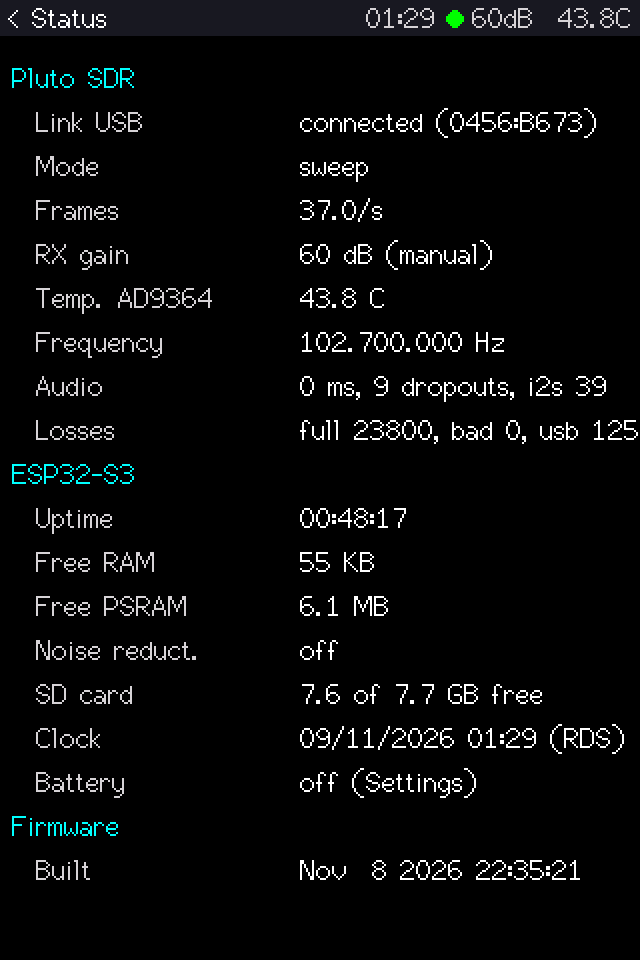

# Status

[← Back to README](../../README.md)

The state of the whole device on one screen:

- **Pluto SDR**: USB link, radio mode, frames per second, RX gain (and whether it is AGC or manual),
  radio chip temperature, frequency, audio buffer and its dropouts, losses.
- **ESP32-S3**: uptime, free RAM and PSRAM, noise reduction, SD card (free space), clock (with its
  source: RDS, manual or radiosonde GPS) and battery.
- **Firmware**: build date.
