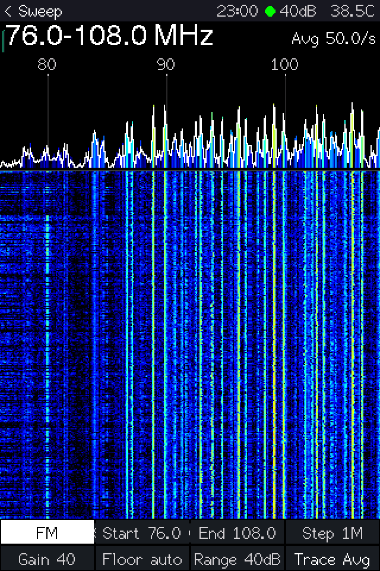
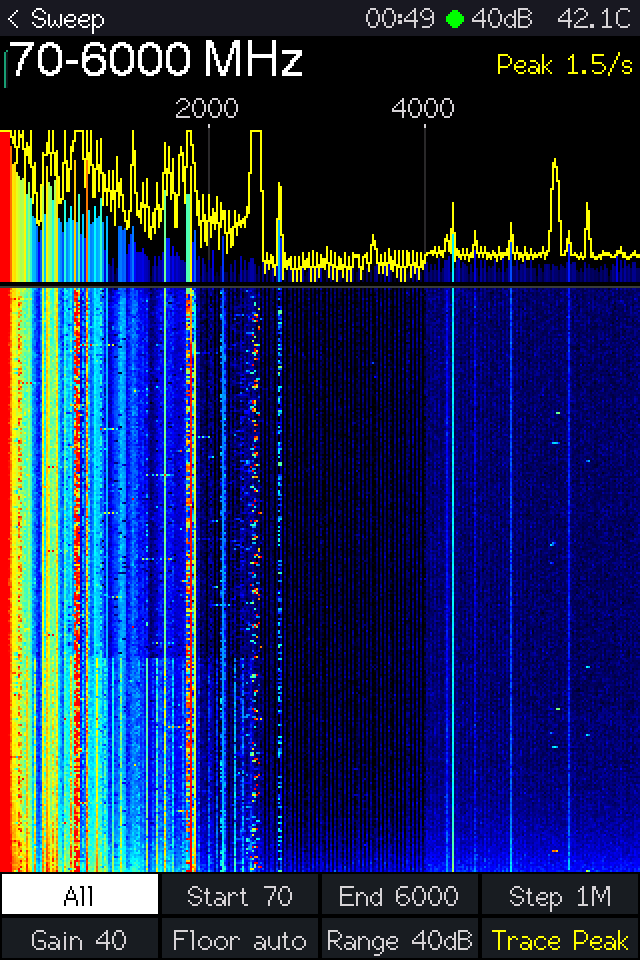

# Sweep

[← Back to README](../../README.md)

 

Shows a wide band at once, built from radio hops. Left: the FM band (76–108 MHz) with the average
trace. Right: the whole range, 70 MHz to 6 GHz, with the peak trace.

- **Ready-made bands**: All, VHF/UHF, FM, Aviation, 2 m, Marine, UHF, ISM 433, ISM 915, GSM 900,
  1–2 GHz, WiFi 2.4, WiFi 5, or a manual range (**Start**, **End**, **Step**).
- **Tap** a point to open the [Spectrum](spectrum.md) there.
- The same **traces** as the Spectrum, through the **Trace** cell or by tapping the right corner of
  the header (the average is over the last 4 sweeps). The header shows the trace and the sweeps per
  second.
- The whole range (70 MHz–6 GHz) runs at about 1.5–2 sweeps per second.
