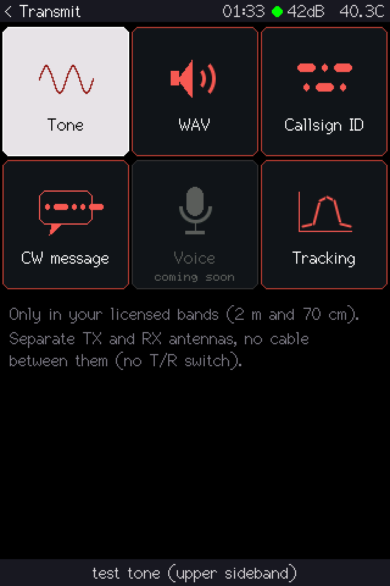
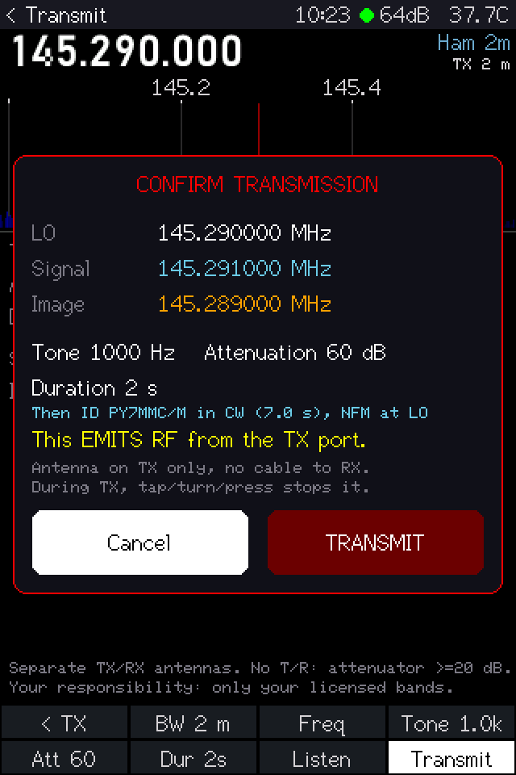
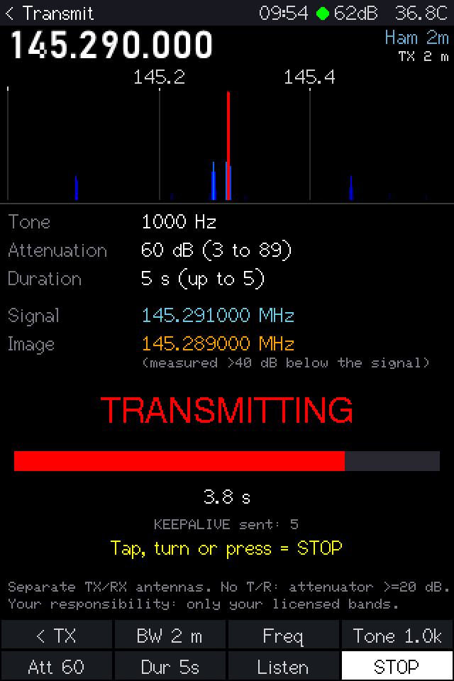
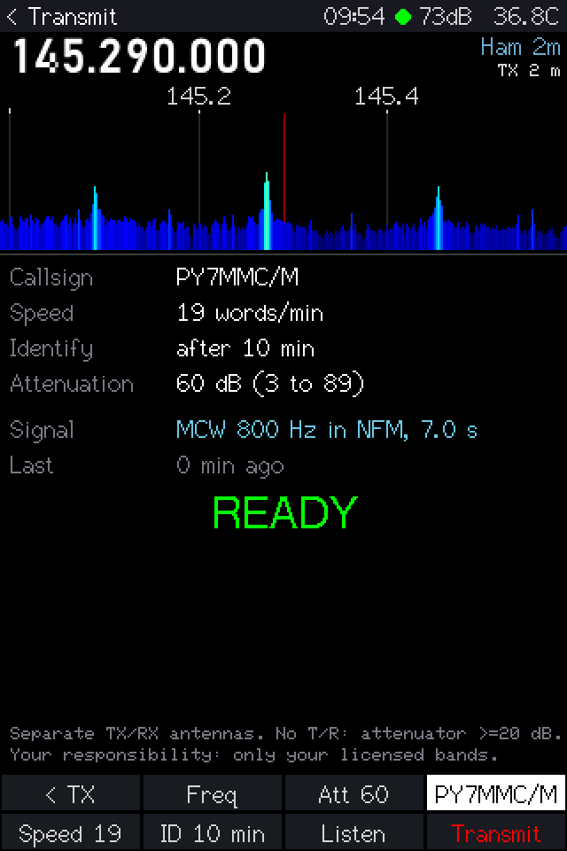
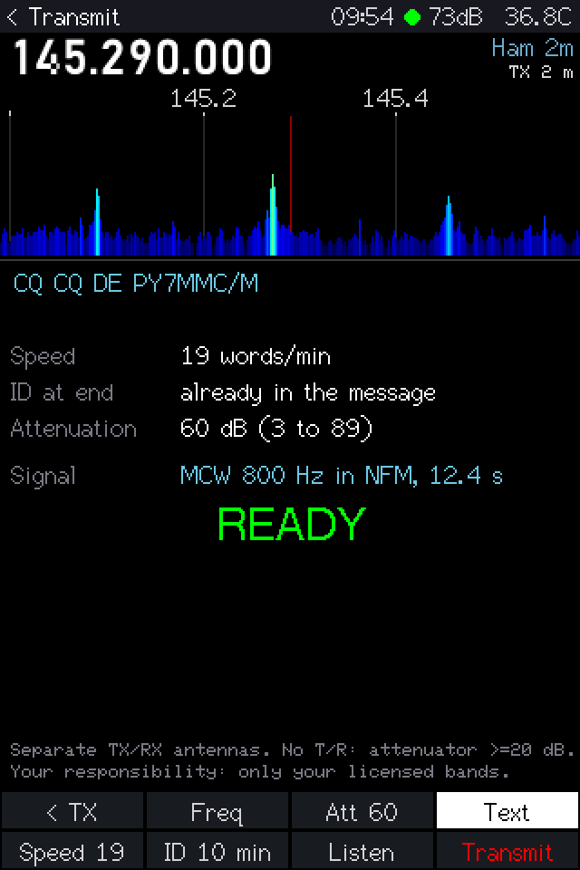
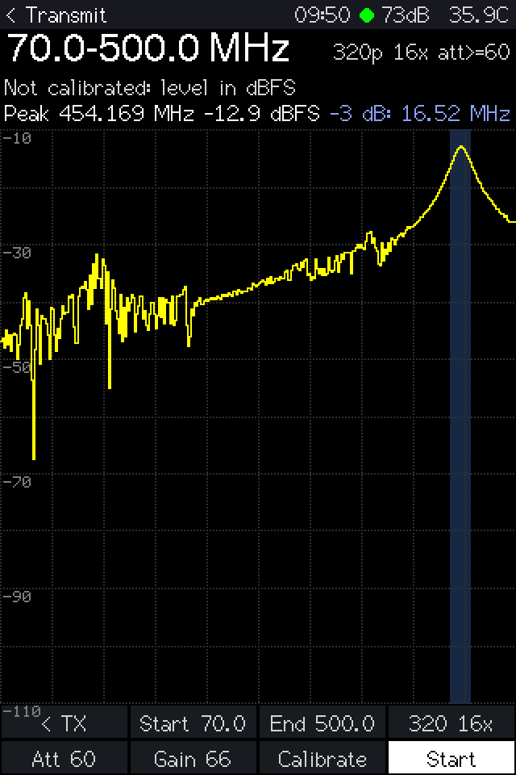

# Transmit (licensed radio amateurs)

[← Back to README](../../README.md)

Transmits from the Pluto's TX SMA, **only on the 2 m (144–148 MHz) and 70 cm (430–440 MHz) amateur
bands**. Use it only within your license privileges and with a proper antenna; there is no T/R
switch, so use separate antennas for TX and RX.

The app opens on an icon menu (the last one used is already selected; **< TX** in the bar comes back
to it).

## Tone

 

A test tone (100 Hz–20 kHz) in upper sideband (the signal comes out at LO + tone), with the chosen
attenuation (**Att**) and duration (**Dur**, 1–5 s). Left: the confirmation before every
transmission. Right: transmitting, with the time left and the keep-alive count.

## WAV

Transmits a `.wav` file from the card's `/tx` folder (16-bit PCM, 8–96 kHz, mono or stereo; becomes
48 kHz mono) in **NFM** (±5 kHz deviation), **USB** or **LSB**. The duration comes from the file
length (up to 3 min per transmission).

## Callsign ID

Your callsign in Morse (an 800 Hz tone in NFM, 15–25 words per minute), on its own or **at the end
of transmissions**: always, only if 10 min have passed since the last one, or never. After a WAV it
goes in the same transmission; after the Tone, in a second transmission, only if the tone ended
normally. The confirmation shows whether the ID will go out. The callsign is saved.

## CW message

Your own text in Morse (up to 64 characters: letters, digits, space and . , ? / = + - ( ) @), for
example "CQ CQ DE PY7ABC K", with the same speed and tone as the ID. The callsign goes at the end, in
the same transmission, by the same rule, unless the message already has it. The message is saved.

## Tracking generator

70–500 MHz: the TX sweeps a tone and the RX measures, point by point, what passed through whatever
is between them (filter, cable, attenuator). **Calibrate** with a direct cable (the average of 4
sweeps becomes 0 dB), then put the device under test in between: the curve shows the gain or loss,
with the peak, the −3 dB bandwidth and a marker (tap the curve). Above: an uncalibrated sweep in
dBFS, between two antennas.

- The **measure** cell (e.g. "320 16x") chooses the points (51–320), the **integration** (1, 4 or 16
  blocks added per point on the Pluto: noise 0, −6 or −12 dB; a 201-point sweep takes ~2, ~3 or
  ~7 s) and the screen **average** (1–16 sweeps, removes the ripple).
- RX gain 60 dB by default.
- Minimum attenuation **10 dB inside 2 m/70 cm** (the whole range, up to 200 kHz above the end) and
  **60 dB outside** (≤ −62 dBm, below what an unlicensed device may radiate even with an antenna);
  the distress frequencies (121.5, 156.525, 156.8, 243, 406 MHz) stay silent.
- Made for use **with cables**.

**Voice** is gray ("coming soon").

## Listening and monitor

With Tone, WAV, Callsign ID or CW message open, the device listens to the frequency in NFM (volume
and squelch from the Audio app; **Listen** cell). During the TX the **monitor** can be the receiver
itself (you hear your transmission), a **copy** of the audio sent, or **mute**.

## Protections

They work on both sides (the real guard is on the Pluto):

- **On-screen confirmation** before each transmission (frequency, signal, image, attenuation and
  duration); the default button is Cancel.
- **One transmission per arming**: the ESP32 arms the TX (valid for 10 s) and only then sends the
  transmission.
- **Minimum attenuation of 3 dB** (3 to 89 dB; below 50 dB the bar says "strong", below 20 dB the
  confirmation asks for a low-pass filter and forbids a direct cable to the RX). In the tracking
  generator the floor is 10 dB on 2 m/70 cm and 60 dB elsewhere. Outside the limits the Pluto refuses
  without touching the radio.
- **Frequency, signal and image inside the band**: for the tone, LO, LO + tone and LO − tone (measured
  on the prototype, the image was at least 43 dB below the signal); for WAV, LO ± 24 kHz.
- **Automatic cut-off**: the ESP32 sends a keep-alive every 200 ms (with WAV, each audio chunk
  counts); without it for 500 ms the Pluto stops by itself. A freeze or a slow redraw only drops the
  TX.
- **Any touch, turn or click during TX stops it**; so does leaving the app. Changing the radio mode on
  the Pluto (START, SPAN, AUDIO, XO...) drops a TX in progress.
- The Pluto turns the TX on at minimum gain and only then applies the requested level, **read back**;
  when stopping, it cuts the gain before turning the oscillator off.

The panel shows the state (ready, arming, starting, transmitting, stopping), the time left and the
result (finished, cut off for lack of keep-alive, stopped by you, refused and why).
