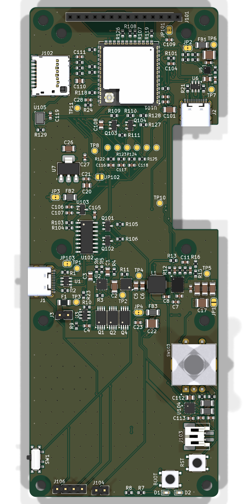
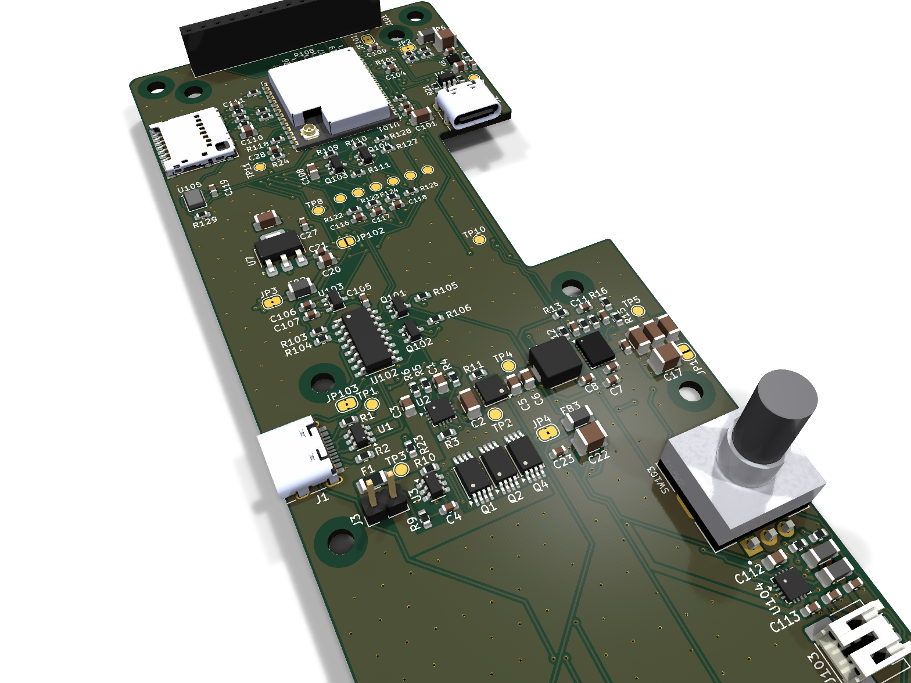
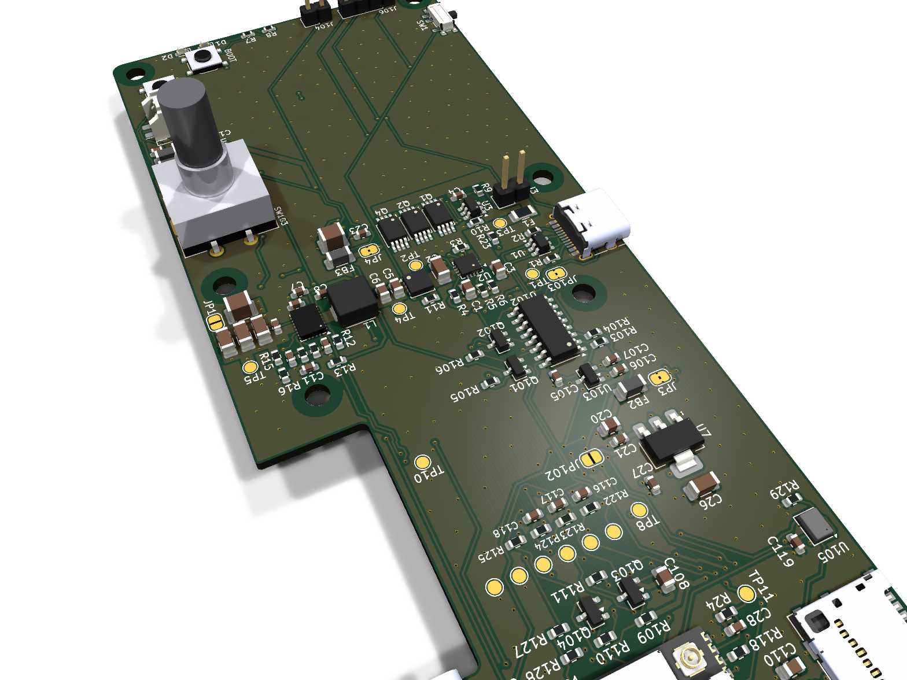

# Main board (PCB)

The main board of the portable SDR. It carries the battery, its charger and protection, the 5 V boost converter,
the ESP32-S3 with the display, microSD, audio and controls, and it powers the **Pluto SDR**. The Pluto stays a
separate module, mounted behind the board and connected by one short USB-C cable for both data and power.

Designed in **KiCad 10**, 4 layers, about **58 × 150 mm**, built for JLCPCB (assembly files included).

| Front (layout) | 3D |
|---|---|
|  | <br> |

Status: schematic and layout finished and checked (DRC: 0 errors, 0 unrouted; every one of the 526 pins matches the
schematic; the firmware pin map in `sdr/pins_config.h` is checked against the netlist). **Not built yet.**

## Contents

| Folder | What is in it |
|---|---|
| `kicad/` | KiCad 10 project: `placa.kicad_pro` (open this), schematic (`placa.kicad_sch` with two sheets: `energia.kicad_sch` power, `esp32.kicad_sch` ESP32 and peripherals), `placa.kicad_pcb`, design rules (`placa.kicad_dru`, JLCPCB 4-layer), project footprints/symbols (`proj.pretty`, `proj.kicad_sym`) and 3D models (`3d/`) |
| `fabrication/` | `gerbers_jlcpcb.zip` (Gerbers + drill), `bom_jlcpcb.csv` (with LCSC part numbers and quantity per board), `cpl_jlcpcb.csv` (pick and place, rotations already checked in the JLCPCB 3D preview), `lcsc_order.csv` (one line per LCSC part, quantities for one board) |
| `images/` | Renders and the schematic (`schematic.pdf`, and one SVG per sheet) |

Schematic: [power](images/schematic_power.svg) · [ESP32 and peripherals](images/schematic_esp32.svg) · [PDF](images/schematic.pdf)

## How the board works

```
USB-C J1 ──► BQ24074 charger ──► SYS ──► power switch (SW1 + P-MOS Q3) ──► TPS61088 boost ──► +5 V
                │  ▲                                                               │
                ▼  │                                                               ├─► JP2 ► ferrite ► eFuse ► USB-C J2 ► PLUTO
       battery J3 (7 A fuse,                                                       ├─► JP3 ► ferrite ► AMS1117 ► 3.3 V ► ESP32, SD, display, mic
       DW01A + 8205A protection)                                                   └─► JP4 ► ferrite ► MAX98357A ► speaker
```

1. **Battery (J3)**: one LiPo cell soldered to the two holes (+ on pin 1), through a 7 A fuse and a DW01A + 2× 8205A
   protection (over-charge, over-discharge, short circuit). A third 8205A footprint (Q4) is left unpopulated.
2. **Charging (J1, BQ24074)**: the USB-C port charges the battery (0.89 A) and powers the device at the same time
   (power path, 1.46 A input limit). Red LED = charging, green LED = on USB power; the ESP32 also reads "on USB power"
   on GPIO21.
3. **On/off (SW1)**: the slide switch turns on a P-MOS between the system rail and the boost. When off, nothing after
   it draws current.
4. **Boost (TPS61088)**: 3.0–4.2 V → 5.1 V, ~1 MHz.
5. **Three 5 V branches**, each with a solder jumper (cut it to measure the current) and its own ferrite:
   - **Pluto**: TPS259470A eFuse (2.5 A limit, UVLO 4.56 V, OVLO 5.68 V), then USB-C **J2**. The ESP32 is the USB host:
     the same cable carries 5 V and USB data. J2 has 56 kΩ pull-ups on CC (source) and USBLC6 ESD protection.
   - **ESP32**: AMS1117 → 3.3 V for the ESP32-S3-WROOM-1U, microSD, display and microphone.
   - **Audio**: MAX98357A class-D amplifier → JST-PH speaker connector.
6. **Programming**: the same USB-C J1 goes to a CH340C (own 3.3 V regulator) with auto-reset, so the ESP32 is
   flashed without pressing BOOT. BOOT and RESET buttons are on the board anyway.
7. **Battery voltage**: 300 k / 100 k divider to GPIO1 (same as the firmware's `BAT_DIV = 4`).

### Board map

| Area | Parts |
|---|---|
| Top edge | Display socket J101 (14 pins, 3.5" ILI9488 module) |
| Top | ESP32-S3-WROOM-1U (U.FL connector for an external antenna), microSD J102, microphone ICS-43434 (sound hole in the PCB) |
| Top right | USB-C **J2 to the Pluto**, eFuse, ESD; the cut-out under J2 leaves room for the cable plug |
| Middle | 3.3 V regulator, CH340C + auto-reset, encoder pull-ups, test points |
| Left edge | USB-C **J1** (charge and program) |
| Middle | Charger, battery holes J3, fuse, protection, power switch MOSFET, boost (inductor and output caps), branch jumpers and ferrites |
| Bottom | Rotary encoder, MAX98357A + speaker connector, BOOT/RESET, LEDs, power switch SW1, PTT (J104) and expansion (J106, GPIO 38/48) headers |

### Solder jumpers

| Jumper | Default | Use |
|---|---|---|
| JP2 / JP3 / JP4 | closed | Cut to measure the current of the Pluto / ESP32 / audio branch |
| JP1 | open | Close to force the boost into fixed PWM |
| JP101 / JP102 | JP101 closed | Display supply: 3.3 V (default) or 5 V (cut JP101, bridge JP102) |
| JP103 | closed | CH340C at 3.3 V (leave it) |

Test points: TP1 VBUS, TP2 SYS, TP3 battery after the fuse, TP4 boost input, TP5 +5 V, TP6 Pluto 5 V, TP7 Pluto VBUS
(after the eFuse), TP8 3.3 V, TP9/TP10 GND, TP11 battery-sense pin. Bring-up order: USB only (TP1, TP2, green LED) →
battery and switch (TP5 ≈ 5.1 V) → TP8 3.3 V and flash the ESP32 → connect the Pluto last.

## Designed for low RF noise

This board replaces a breadboard/perfboard build in which most of the receiver's problems were noise made by the
device itself (display SPI edges, the audio amplifier, the boost, currents on the cables). The layout addresses each
of them:

- **4 layers with a solid ground plane** (layer 2, 92 % of the board in one piece) right under every top-layer signal,
  so return currents stay short and under their traces.
- **Ground pour on the top and bottom layers**, stitched to the inner plane with ~200 vias every ~3.5 mm: no floating
  copper, a closed "box" around the signals.
- **Separate filtered 5 V branches**: Pluto, ESP32 and audio each have a ferrite bead and local capacitors, so the
  switching noise of one load does not reach the others; the Pluto branch also has an eFuse.
- **100 Ω series resistors at the ESP32** on display SCK/MOSI, microSD SCK/MOSI and I2S BCLK/LRCK/DOUT, which slow the
  edges that used to show up as spurs and a "robotic" sound in FM (measured on the prototype).
- **Speaker outputs filtered** with a ferrite and a capacitor to ground on each line (MAX98357A EMI filter); on the
  prototype the amplifier was the largest single noise source.
- **Compact boost layout**: input caps, inductor, IC and output caps close together on a copper area, with thermal vias,
  to keep the high-current switching loop small.
- **Wide power paths**: the Pluto branch is 1 mm wide end to end (plus copper areas and 4 vias from the plane);
  the battery, system and boost paths run on copper areas.
- **USB data** routed as pairs over the ground plane, with ESD protection at both USB-C connectors.
- Decoupling capacitors within ~3.5 mm of every IC supply pin.
- External antenna connector on the ESP32 module (WROOM-1U) instead of a PCB antenna.

## Component changes from the prototype

The prototype used ready-made modules on a perfboard. On this board they became parts soldered on the PCB, and some
were replaced:

| Prototype | On this board | Why |
|---|---|---|
| ESP32-S3 DevKitC-1 (N16R8) | ESP32-S3-WROOM-1U-N16R8 module | Same chip and memory, much smaller, external antenna (U.FL) |
| USB on the DevKit | CH340C + auto-reset on the charge USB-C | Program and charge through one port |
| TP4056 charger module | **BQ24074** | Power path (runs from USB while charging), current limits set by resistors, charge/power LEDs |
| XL6009 boost, then MT3608 | **TPS61088** | The XL6009 did not start under load from a single cell; the MT3608 reset the device under the Pluto's load. The TPS61088 (already tested on a module) holds the whole device |
| DW01A + FS8205A (TP4056 module) | DW01A + 2× 8205A (HXY), 3rd optional | FS8205A discontinued at LCSC; two in parallel for less loss |
| Direct 5 V wire to the Pluto | **TPS259470A eFuse** + USB-C source port | Short-circuit and over/under-voltage protection for the Pluto; the TPS259472A had no stock |
| — | CSD25402Q3A P-MOS + slide switch | Real on/off switch (the AON6411 is not available at JLCPCB) |
| MAX98357 module | MAX98357A chip | On the board, with the EMI output filter |
| INMP441 microphone module | **ICS-43434** soldered on the board | INMP441 out of stock; same I2S interface |
| microSD module | Molex 104031-0811 socket | On the board, 3.3 V only |
| KY-040 encoder module | **Bourns PEC11R-4015F-S0024** | One pulse per detent, as the firmware expects; mounts on the board |
| Jumper wires to the display | 14-pin socket | Display plugs directly on the board |

## Ordering

- PCB: upload `fabrication/gerbers_jlcpcb.zip` (4 layers, 1.6 mm).
- Assembly at JLCPCB: `bom_jlcpcb.csv` + `cpl_jlcpcb.csv`. The encoder SW103 is through-hole and is not in the CPL
  (JLCPCB warns about it; continue and solder it by hand). Unpopulated on purpose: Q4, C12, C116–C118, R111, R121,
  J104, J106.
- Hand assembly: order the PCB with a top stencil and the parts from `lcsc_order.csv`. The QFN parts (BQ24074,
  TPS61088, TPS259470A, MAX98357A), the ICS-43434 microphone, the CSD25402 and the ESP32 ground pad need hot air or a
  hot plate; the rest can be done with an iron.
- Hand-soldered parts in any case: encoder SW103, 1×14 female header for the display (J101), battery wires (J3).
